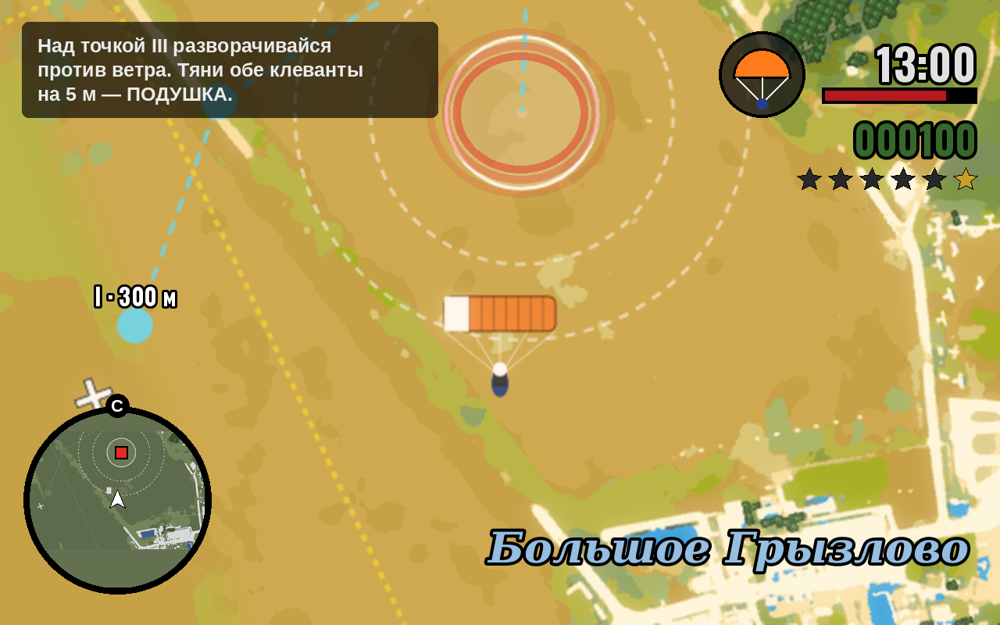
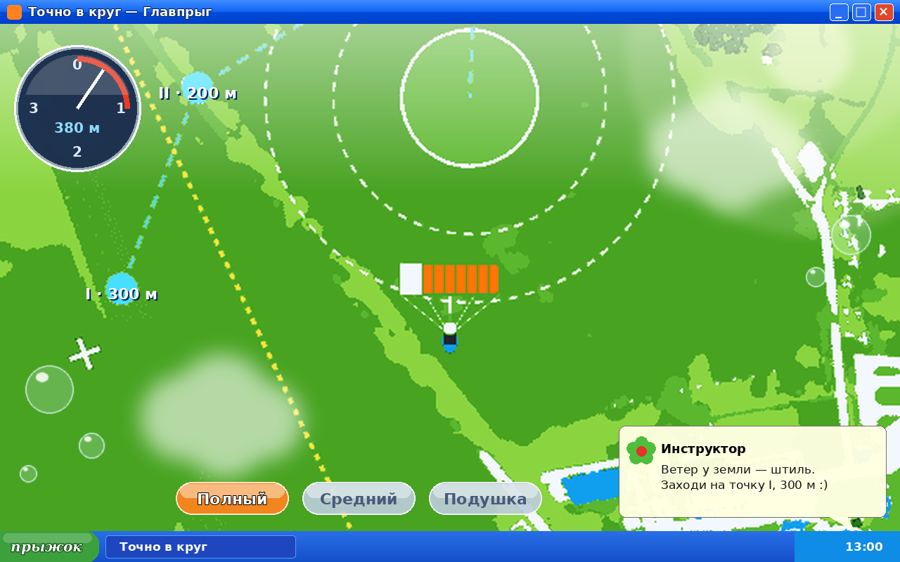
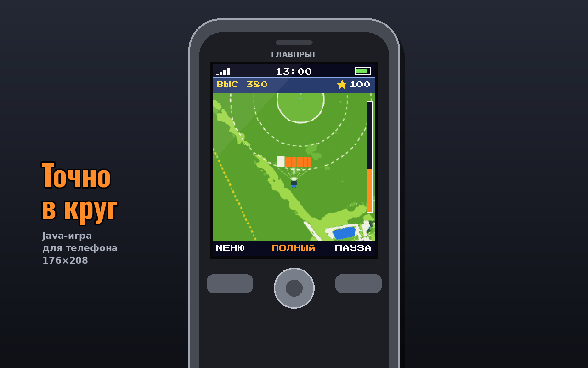

# «Точно в круг» — стили главного вида из 2000-х

*18.10.2026. Вторая проба: «Денди», «Сега» и «Гейм бой» — это детство
постарше. Здесь отсылки к тому, во что играли миллениалы в 2000-х. Эскизы
сделаны программой из настоящего кадра игры (`igra/tools/stil-2000.py`).
Это проба стиля, а не финальная отрисовка.*

## 1. «Сан-Андреас» — PS2

Узнаётся с первого взгляда, и в той игре тоже прыгали с парашютом. Элементы:

- мыльная картинка с оранжевой дымкой и свечением;
- круглый радар слева внизу: круг на нём — красный маркер, видно, куда лететь;
- чёрная плашка-подсказка слева сверху;
- справа часы, значок парашюта вместо оружия, полоска, зелёные «деньги» —
  очки, звёзды розыска — уровень;
- название района курсивом справа внизу — «Большое Грызлово»;
- на круге — красный светящийся маркер, как контрольная точка миссии.

Радар и подсказка здесь полезны и для игры, а не только для настроения.

## 2. «Икс-Пи и глянец» — Windows XP и глянцевые 2000-е

Игра в окне XP: синий заголовок, панель задач, вместо «Пуска» кнопка
«прыжок». Карта в зелени обоев «Безмятежность», глянцевый блик, мягкие
облачка, пузыри. Режимы купола — гелевые кнопки-«пилюли», высотомер —
стеклянный гаджет. Подсказки инструктора всплывают сообщением, как в «аське».
Ближе всего к сайту: те же стеклянные плашки, небесные цвета, градиенты.
Глянец 2000-х (Frutiger Aero) сейчас снова в моде.

## 3. Java-игра на телефоне

Экран 176×208 в корпусе «звонилки» с джойстиком. Над картой строка связи
и часы, табло с высотой и очками, шкала высоты. Внизу софт-клавиши «МЕНЮ ·
ПОЛНЫЙ · ПАУЗА». Тёплая отсылка ко временам, когда игры качали на телефон
через WAP. Вертикальный экран, как раз для мобильной версии.

## Что предлагаю

- **Игровой экран — «Сан-Андреас».** Радар с маркером, подсказки,
  название района, звёзды-уровни — это и отсылка, и понятный интерфейс.
- **Стартовый экран, меню, итог прыжка и страница игры — глянец «Икс-Пи».**
  Он совпадает со стеклом и градиентами сайта, и игра с сайтом выглядят
  одним целым.
- **Java — бонусный режим** (открывается за серию побед) или оформление
  вертикальной версии для телефона.

**Права.** Логотипов, шрифтов и названий чужих игр и программ не берём —
только узнаваемые приёмы: радар, часы, плашка, окно, гелевые кнопки.
Шрифты — свободные (Oswald, Press Start 2P, DejaVu).

Работы под выбранный стиль:

- приборы и подсказки — заново, поверх нынешней игры;
- перекраска карты — в коде на лету, как в эскизах;
- спрайт купола оставляем: он везде читается.
