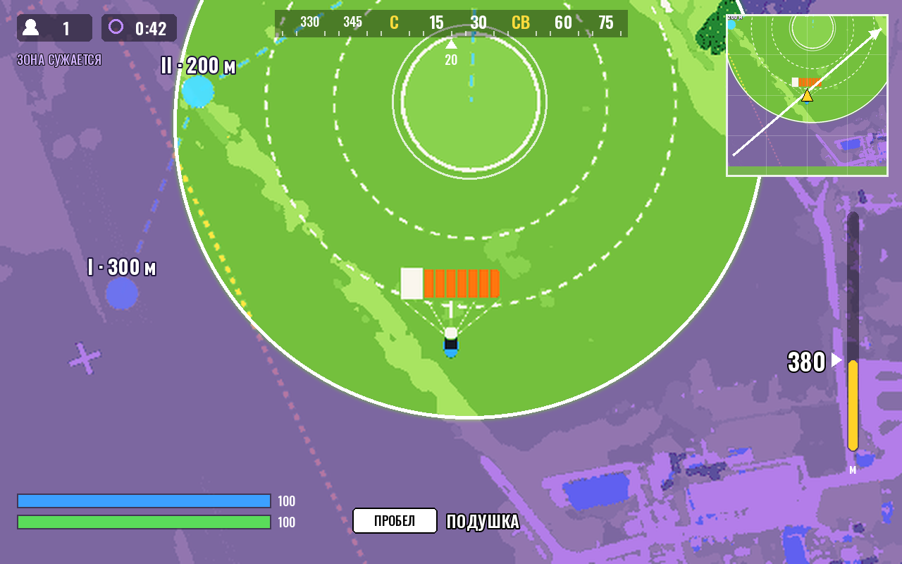
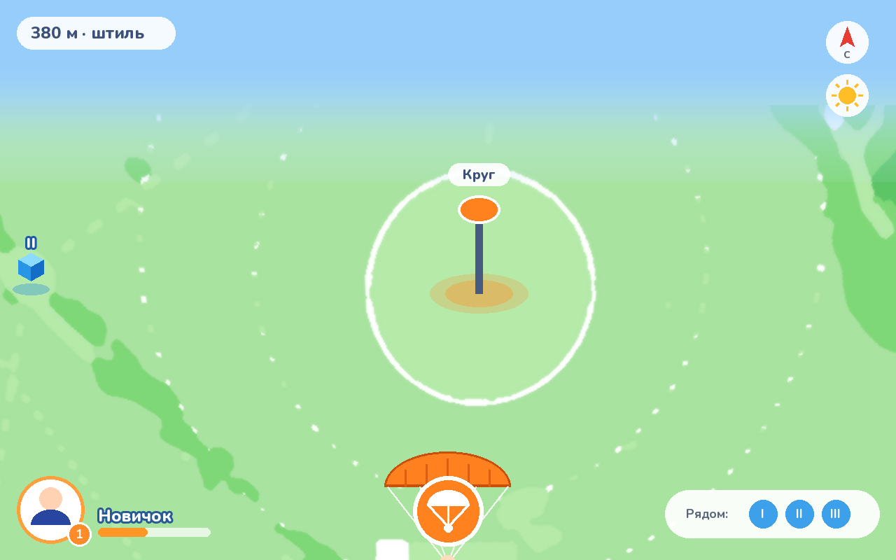
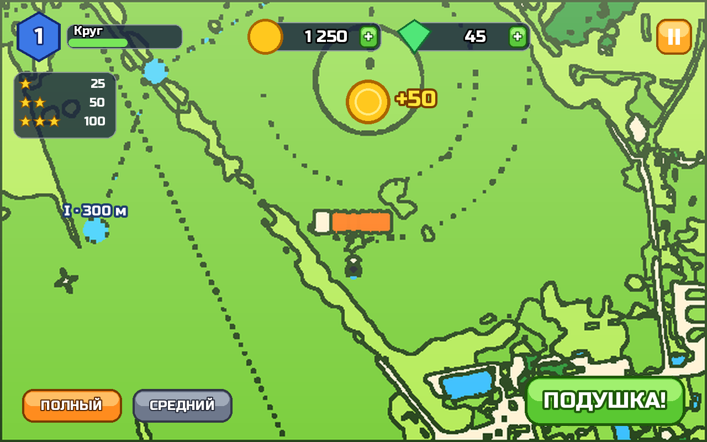

# «Точно в круг» — стили главного вида из 2010-х

*18.10.2026. Третья проба после 8–16 бит и 2000-х. Здесь отсылки к играм
2010-х — времени смартфонов, стримов и «королевской битвы». Эскизы сделаны
программой из настоящего кадра игры (`igra/tools/stil-2010.py`). Это проба
стиля, а не финальная отрисовка.*

## 1. «Королевская битва» — Fortnite и PUBG

Прыжок с самолёта и парашют — это начало каждого матча в «батл-рояле», так
что отсылка здесь прямая. Элементы:

- сочная перекраска карты, вне безопасной зоны — фиолетовый «шторм»;
- лента компаса сверху с градусами и сторонами света;
- мини-карта справа вверху: маршрут самолёта, стрелка игрока, зона;
- слева вверху — число игроков, таймер и «ЗОНА СУЖАЕТСЯ»;
- справа — шкала высоты, слева внизу — полоски щита и здоровья;
- подсказка клавиши «ПРОБЕЛ — ПОДУШКА».

Самый «геймерский» вариант. Компас и мини-карта полезны и для игры.

## 2. «Гео-игра» — Pokémon GO

Карта в мягкой мятной гамме с наклоном и небом у горизонта, как в
гео-играх на телефоне. На круге — маяк с подписью, точки захода — синие
кубики. Внизу аватар «Новичок» с уровнем, большая круглая кнопка с куполом,
плашка «Рядом: I II III», справа кнопки компаса и солнца. Самый спокойный и
«мобильный» вариант. Чужих элементов не берём — кнопка своя, оранжевая с
куполом, а не узнаваемый «шарик».

## 3. «Казуалка» — мобильные игры 2010-х (Angry Birds, Clash of Clans)

Мультяшная карта с толстым контуром, яркие объёмные кнопки. Над кругом
монетка «+50». Сверху — шестиугольник уровня со шкалой опыта, счётчики монет
и кристаллов с зелёными «+», оранжевая пауза. Слева — цели на три звезды
(25 / 50 / 100 очков). Внизу кнопки режимов купола и большая зелёная
«ПОДУШКА!». Узнаваемо и понятно любому, кто играл на телефоне.

## Что предлагаю

- **Игровой экран — «Королевская битва».** Компас, мини-карта и зона —
  одновременно отсылка и рабочие приборы. Шторм за кругом наглядно
  показывает, куда лететь не надо.
- **Звёзды за прыжок и итоговый экран — из «казуалки».** Три звезды, монеты,
  большие кнопки — привычная мобильная механика возврата в игру. Магазин и
  «кристаллы» не нужны: валюта только как очки.
- **«Гео-игра» — для мобильной версии** или режима «прыжок над своим
  районом»: она лучше всех подходит для вертикального экрана и сочетается
  с небесными цветами сайта.

**Права.** Логотипов, шрифтов, персонажей и названий чужих игр не берём —
только жанровые приёмы: шторм, компас, мини-карта, звёзды, объёмные кнопки.
Шрифты — свободные (Oswald, Nunito, Russo One, DejaVu).

Работы под выбранный стиль:

- приборы — заново, поверх нынешней игры;
- перекраска карты — в коде на лету, как в эскизах;
- спрайт купола оставляем: он везде читается.
