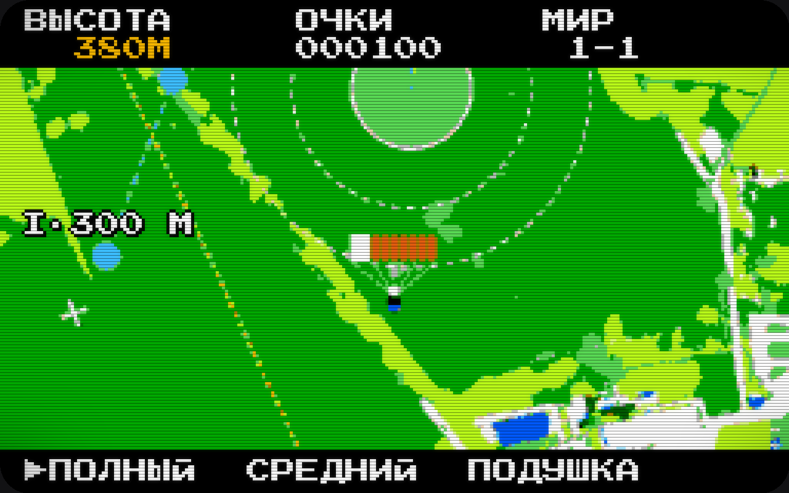
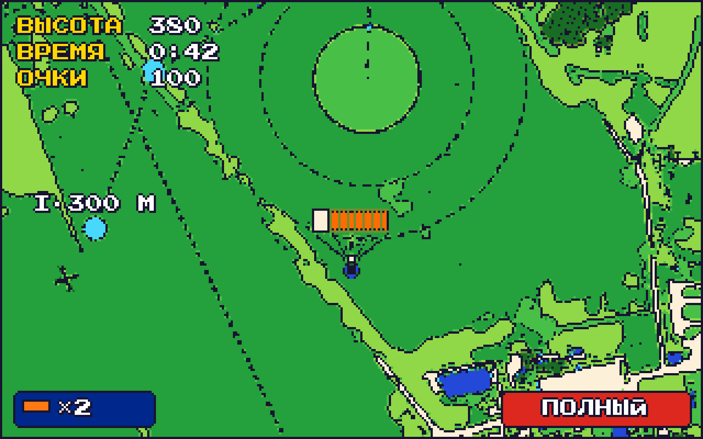
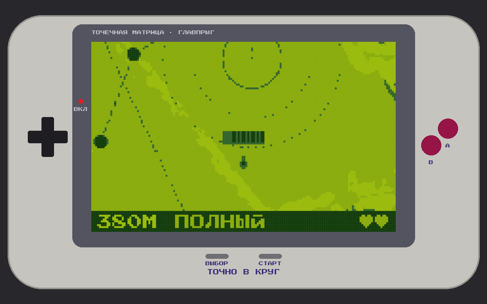

# «Точно в круг» — три стиля главного вида

*18.10.2026. Эскизы сделаны программой из настоящего кадра игры
(`igra/tools/stil-varianty.py`): та же карта, тот же купол, та же коробочка.
Это проба стиля, а не финальная отрисовка.*

## Что сейчас

- **Карта** — плакатная перекраска снимков: пятна и «шум», но не пиксели.
- **Купол и самолёт** — плоский вектор.
- **Приборы** — современный системный шрифт на полупрозрачных плашках.

Получается три визуальных языка сразу. В ТЗ обещан стиль 16-битных приставок,
а картинка на него не похожа. С сайтом (жирный гротеск капсом, оранжевый
градиент, тёмно-синие плашки) игру роднит только оранжевый купол.
Отсылки к детству миллениалов пока нет.

## 1. «Денди» — 8 бит

Палитра NES, крупный пиксель, телевизор с кинескопом: строки развёртки,
тёмные углы. Табло — как в «Марио» («ВЫСОТА · ОЧКИ · МИР 1-1»), режим
купола выбирается стрелочкой, как в меню картриджа. Самый узнаваемый
вариант для России 90-х: «Денди» был почти в каждом доме. Оранжевый купол
на зелёном читается отлично.

## 2. «Сега» — 16 бит

Сочная зелень, тёмный контур по краям полей и спрайтов, табло как у
«Соника»: жёлтые подписи и белые цифры. Внизу слева — «жизни» (запасной
парашют ×2), справа — плашка режима. Ближе всего к ТЗ («16 бит»). Круг,
кольца зон и точки захода читаются лучше, чем в других вариантах. Легче
всего связать с сайтом: красную плашку меняем на оранжевый Главпрыга,
синюю — на тёмно-синий.

## 3. «Гейм бой» — карманная приставка

Четыре оттенка зелёного на жидкокристаллическом экране с сеткой точек,
корпус с крестовиной и кнопками A и B. Самый атмосферный вариант. Но из-за
четырёх оттенков зоны и вода читаются хуже — для основного режима беднее.

## Что предлагаю

- **Основа — «Сега».** Это 16 бит, как в ТЗ, и он лучше всего ложится на
  цвета сайта.
- **«Денди» и «Гейм бой» — бонусные «картриджи».** Открываются за серию
  побед или для зарегистрированных. Это и есть отсылка к детству, и повод
  вернуться в игру.
- **Единый пиксельный шрифт с кириллицей** во всех стилях (Press Start 2P,
  свободная лицензия OFL). Он же — на странице игры в заголовках.

Работы под выбранный стиль:

- перекраска карты по классам (поле, лес, вода, дороги) — в коде на лету,
  как в этих эскизах;
- купол, парашютист и самолёт — заново, в пиксель-арт;
- приборы — пиксельным шрифтом вместо системного;
- вид сбоку и стартовый экран — в том же ключе.
