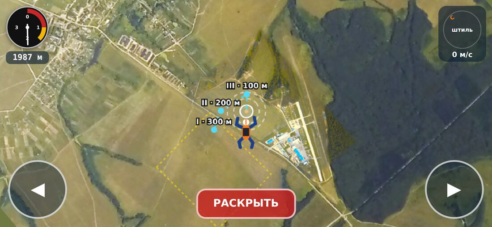
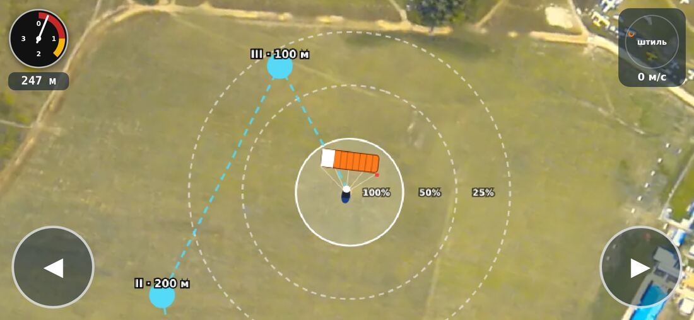
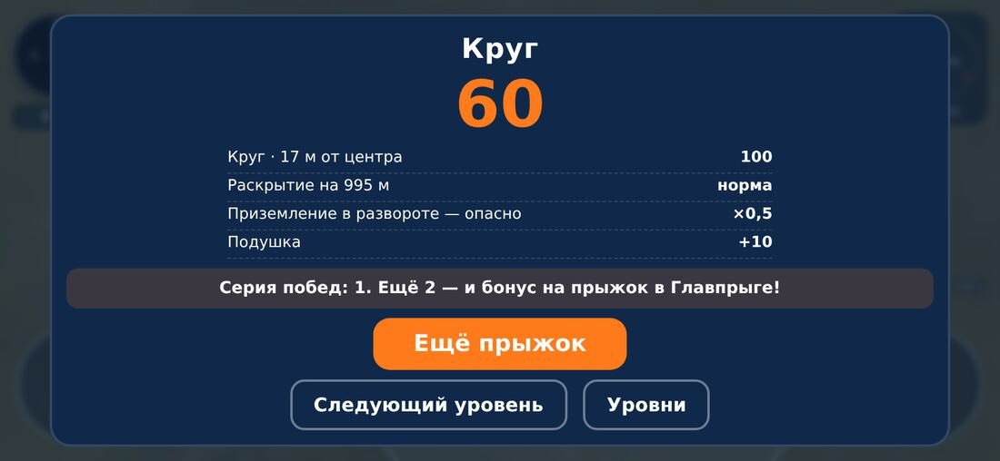

# ТЗ: браузерная игра «Точно в круг» для сайта Главпрыга

**Редакция 1 · 15.10.2026**

## 1. Зачем игра

Короткая игра для сайта Главпрыга: человек прыгает с парашютом над аэродромом
Большое Грызлово, строит заход по ветру и садится в круг. Задачи:

- **привести людей на сайт и вернуть их туда** — прыжок длится 1–2 минуты, хочется
  «ещё раз», есть уровни и рекорды;
- **превратить игроков в зарегистрированных клиентов** — статистика копится
  в личном кабинете, за серии побед даются бонусы и скидки на прыжок;
- **подвести к настоящему прыжку** — правила в игре взяты из учебного пособия AFF
  ДЗ Пущино: высоты, колдун и стрелка, заход «коробочкой», приоритеты приземления.

**Показатели успеха** (Яндекс.Метрика): число начатых прыжков, доля
доигранных, повторные визиты через 1 и 7 дней, регистрации из игры,
использованные промокоды.

## 2. Устройства и скорость

### 2.1. Где игра должна работать

| Класс | Что входит | Экран |
|---|---|---|
| Телефон — **основной** | Android 8+ (Chrome, Яндекс Браузер, Samsung Internet), iPhone с iOS 14+ (Safari) | **только горизонтально**; в вертикальном положении — заставка «Поверните телефон» |
| Планшет | iPad, планшеты Android | горизонтально; вертикально — допускается, интерфейс подстраивается |
| Компьютер | Chrome, Edge, Firefox, Safari последних двух лет | окно любого размера, от 1024 × 600 |

«Почти все устройства» понимается так: игра запускается и играется на телефоне
уровня 2019 года с 2 ГБ памяти (например, Samsung Galaxy A10, Redmi 7).

### 2.2. Бюджет скорости

| Показатель | Предел | В макете |
|---|---|---|
| Вес игры полностью (код, карта, графика, без звука) | ≤ 600 КБ | ≈ 460 КБ |
| Вес до первого экрана | ≤ 150 КБ | ≈ 37 КБ (страница с кодом) |
| Звук (если будет) | ≤ 150 КБ, грузится после старта | — |
| Время до кнопки «Прыгать!» на 4G | ≤ 2 с | — |
| Кадров в секунду | 60 на среднем телефоне, не ниже 30 на слабом | — |
| Память | ≤ 150 МБ | — |
| Сторонние движки и библиотеки | не нужны | нет |

Как это достигается:

- **Canvas 2D, чистый JavaScript**, один файл кода; без игровых движков
  (Phaser, Unity WebGL весят от 1 до 10 МБ и долго стартуют на слабых телефонах);
- **внутреннее разрешение низкое** — 360 точек по высоте, растягивается без
  сглаживания. Это и есть «приставочный» вид, и нагрузка на телефон в 4–9 раз
  меньше, чем при отрисовке в полном разрешении экрана;
- карта — два слоя WebP (дальний и ближний у площадки), маска грунта — маленький PNG;
- если частота кадров падает ниже 40, внутреннее разрешение снижается до 270 точек;
- **service worker** кеширует игру: второй запуск — мгновенно, даже при плохой связи;
- игра встаёт на паузу, когда вкладка скрыта.

### 2.3. Экран и управление по устройствам

| | Телефон | Планшет | Компьютер |
|---|---|---|---|
| Влево / вправо | большие круглые кнопки в нижних углах, под большими пальцами; в падении это **джойстики** (п. 3.1а) | то же | ← → или A D |
| Вперёд / назад в падении | кнопку-джойстик вверх / вниз | то же | ↑ ↓ или W S |
| Фигуры в падении | обе кнопки сразу: вверх, вниз, вбок | то же | Shift + стрелка |
| Торможение (обе клеванты) | обе кнопки сразу | то же | ← и → вместе, или ↓ / S |
| Раскрыть | красная кнопка внизу по центру — только в свободном падении | то же | пробел |
| Подушка «раз» (до середины) | обе боковые кнопки | то же | ↓ |
| Подушка «два» (до конца) | та же средняя кнопка под куполом — держать | то же | пробел или ↑ — держать |
| Во весь экран | сразу по «Играть», экран держится горизонтально. На iPhone Safari полного экрана для страниц нет: окно игры растягивается поверх страницы, подсказка «Проведите пальцем вверх» прячет адресную строку и панели; совсем без браузера — со значка «На экран „Домой“» | то же | кнопка «Во весь экран» |
| Свернуть / развернуть | кнопка под крестиком: снова видны адресная строка и браузер, игра не прерывается | то же | то же |
| Закрыть | крестик справа вверху | то же | то же |
| Экранные кнопки | есть | есть | **нет** — клавиатура, внизу подсказка клавиш |

Кнопки — не меньше 15 мм, отклик на касание, а не на отпускание, держатся
несколькими пальцами одновременно (мультитач). Вырезы экрана учитываются
(`safe-area`). Геймпад — по желанию на втором этапе.

## 3. Игровой процесс

### 3.1. Ход прыжка

1. **Самолёт.** Вид сверху на аэродром Большое Грызлово, самолёт идёт боевым
   курсом против ветра, отсчёт «Приготовиться… Пошёл!».
2. **Свободное падение.** Высота выброски — **2000–4000 м**, по облачности
   (п. 3.3). Парашютист виден со спины,
   головой вверх экрана; карта поворачивается вслед за ним. Из коробочки он
   поворачивает, движется вперёд и назад, выше 2000 м — крутит сальто и
   переворачивается на спину (п. 3.1а); ветер его сносит.
   Масштаб карты меняется с высотой: сверху виден весь район, у земли — площадка.
3. **Раскрытие** — кнопкой. Норма — **не ниже 900 м** и лицом к земле.
   Ниже — штраф; на спине или в фигуре — тоже (×0,5, «риск перехлёста»).
   Не раскрылся до **350 м** — прибор раскрывает запасной (белый купол),
   за прыжок ставится большой штраф, в серию побед он не идёт.
   Раскрытие не лицом к земле в половине случаев даёт **фитиль**: купол вышел,
   но не наполнился, снижение 35 м/с, в строке «ФИТИЛЬ!». Кнопка «Раскрыть»
   (пробел) — отцепка и запасной; не отцепился — прибор на 350 м. Штраф тот же,
   что за запасной.
4. **Под куполом** три режима хода, текущий горит под высотомером:
   отпущены кнопки — **полный вперёд**, обе боковые — **средний режим**,
   средняя кнопка (на месте «Раскрыть»; на компьютере пробел) — **подушка**,
   клеванты до упора. Одна боковая кнопка — разворот в её сторону. Купол
   отвечает с запаздыванием (п. 3.2а).
5. **Заход и приземление** — построение «коробочкой» через контрольные точки,
   посадка против ветра, по стрелке, с полной скорости. С 50 м — вид сбоку и
   подушка «на раз-два» (п. 3.2б).
6. **Итог** — очки, разбор, серия побед, предложение бонуса.

### 3.1а. Свободное падение: фигуры и управление

По программе AFF (уровни 4–7, с. 69–70 пособия): всё начинается и кончается
**коробочкой** — нейтральным положением; повороты и движение вперёд — с 4-го
уровня, заднее сальто — с 6-го, переднее — с 7-го; «на высоте ниже 2000 м
сальто не выполняются»; после каждой фигуры — восстановиться и проверить
высоту. Навыки «движение вперёд-назад», «бочка», «сальто» — там же, с. 74.

| Фигура | Телефон | Компьютер | В игре |
|---|---|---|---|
| Коробочка | ничего не нажимать | — | вперёд не смещается, только ветер |
| Поворот | одна кнопка — в её сторону; увести вбок — в ту сторону и сильнее | ← → | до 55 °/с, набирается за ≈ 0,5 с |
| Вперёд | кнопку вверх | ↑ | до 14 м/с, набирается за ≈ 1,5 с |
| Назад | кнопку вниз | ↓ | до 6 м/с |
| Сальто вперёд / назад | обе вверх / обе вниз | Shift + ↑ / ↓ | полный оборот ≈ 1,5 с; после него курс уходит на ±20° |
| На спину (полубочка) | обе вбок | Shift + ← → | на спине — 56 м/с вниз, медленно крутит, сносит назад |
| Прогнуться | обе кнопки просто держать | Shift | со спины — обратно на живот |

- **Джойстики.** Ручка кнопки ходит за пальцем. Сила движения — от того,
  насколько увёл палец, и от того, сколько держишь (с половины до полной
  за 0,9 с); экран, который знает силу нажатия, задаёт её сразу. Экранных
  кнопок по-прежнему две боковые и средняя «Раскрыть» — новых нет.
- **Ниже 2000 м** сальто и переворот не начинаются, игра говорит «Ниже 2000 м
  фигуры не выполняют — держи коробочку». Вернуться со спины на живот можно
  на любой высоте; на спине ниже 2000 м — тревога «прогнись».
- Положение тела горит под высотомером: «КОРОБОЧКА», «ВПЕРЁД 12 м/с»,
  «САЛЬТО ВПЕРЁД», «НА СПИНЕ — ПРОГНИСЬ» (красным).
- **Очки:** каждая сделанная фигура (сальто вперёд, сальто назад, переворот на
  спину и обратно) — +5, если приземлился на площадку; раскрытие на спине или
  в фигуре — ×0,5.
- Описание управления — в игре (кнопка «Управление» на стартовом экране; на
  компьютере видна колонка клавиш, на телефоне — кнопок) и на странице `/igra`.

### 3.1б. Отделение и поток от винтов

По AFF (с. 21): после отделения горизонтальная скорость самолёта гаснет к
10–12 с, за это время парашютист проходит вперёд 300–350 м, а вертикальная
скорость к 10–15 с дорастает до 50 м/с. При отделении в сторону двигателей
набегает поток от винтов. В игре:

- в момент отделения скорость вперёд — 44 м/с по боевому курсу, вниз — 0;
- дальше квадратичное сопротивление: `vz += (9,8 − k·V·vz)·dt`, вынос гаснет
  как `1 − 0,8·k·V·dt`, где `k = 9,8 / 50²`, `V` — полная скорость; вынос за
  падение — ≈ 250 м (игра сжимает время, книга даёт 300–350 м);
- первые 3 с — **поток от винтов**: случайный толчок вращения, на приборе
  «ПОТОК ОТ ВИНТОВ», в строке «прогнись, коробочка»; потом, пока скорость
  не набрана, — «РАЗГОН ↓X · вперёд Y м/с». Свои движения игрока (вперёд,
  фигура, переворот) прибор показывает поверх этих надписей;
- точка выброски учитывает вынос: она смещена назад по курсу на 250 м.

### 3.2. Физика — по учебному пособию AFF

| Величина | Значение в игре | Источник |
|---|---|---|
| Скорость свободного падения | 50 м/с | AFF, с. 23 |
| Купол, полный режим | 12 м/с вперёд, 5 м/с вниз при любом ветре | требование заказчика (AFF, с. 34: 9–10 м/с) |
| Фитиль (купол не наполнился) | 35 м/с вниз | требование заказчика |
| Купол, средний режим (обе кнопки) | 4 м/с вперёд, 3 м/с вниз | AFF, с. 34 (3–4 м/с) |
| Разворот | до 42 °/с, набирается ≈ за 1 с; снижение растёт до 8,5 м/с | AFF, с. 34 (360° ≈ 5 с, −50…70 м) |
| Подушка (клеванты до упора) | 1,5 м/с вперёд; с полной скорости касание ≈ 1–2 м/с | AFF, с. 39 |
| Раскрытие основного | не ниже 900 м (требование игры) | AFF, с. 45: «не менее 800 м» |
| Запасной от прибора | 350 м | требование заказчика |
| Ветер с высотой | профиль по высотам: по прогнозу дня или по уровню (п. 3.3) | AFF, с. 36 |
| Отделение | вперёд 44 м/с (скорость самолёта), вниз — с нуля; к 10–12 с — ≈ 50 м/с вниз и почти 0 вперёд, вынос ≈ 250 м | AFF, с. 21 (300–350 м) |
| Ветер у земли, предел | 8 м/с для студента, 10 м/с с категорией A | AFF, с. 44 |

### 3.2а. Отклик купола, подушка, сваливание

- **Запаздывание.** Клеванты затягиваются не мгновенно: до упора — за ≈ 0,7 с,
  отпускаются за ≈ 0,55 с. Разворот, скорость вперёд и вниз меняются плавно
  (постоянные времени 0,9 / 1,2 / 1,2 с игрового времени). В падении поворот
  тоже набирается за ≈ 0,5 с, скорость поворота — 55 °/с.
- **Подушка.** Гашение скорости вперёд переходит в подъёмную силу и снижает
  вертикальную скорость. Работает только с полной скорости и только пока
  скорость гасится. Начал на 4–6 м — касание 1–2 м/с. Раньше — купол
  успевает погасить скорость и снова садится на 3–4 м/с. Позже — не успевает.
  Исход касания — п. 3.2б.
- **Сваливание** — купол теряет скорость, падает на 13 м/с, болтается и не
  слушается ≈ 2 с. Восстанавливается, только когда клеванты отпущены.
  Причины:
  - клеванты до упора (подушка) дольше 2,5 с на высоте;
  - резкий разворот ниже 40 м: угловая скорость больше 60 % от предельной
    дольше 0,4 с.

  На приборе мигает «СВАЛИВАНИЕ», в строке — подсказка «отпусти клеванты».
- **Жёсткое приземление** — касание в сваливании или быстрее 7 м/с:
  «Прыжок не засчитан — жёсткое приземление», 0 очков.

Чтобы прыжок не тянулся 4–5 минут, игровое время ускорено: падение — в 2 раза,
купол — в 2,5 раза, 100–50 м — в 1,5 раза. Ниже 50 м — настоящее время:
на посадке нужна точность.

### 3.2б. Посадка видом сбоку

С 50 м игра плавно (0,5 с) переходит из вида сверху в **вид сбоку**: купол в
профиль, стропы, слайдер, парашютист с руками на клевантах. Масштаб растёт по
мере снижения; видны мишень, колышки ±50 м, ветроуказатель, лес, тень.

- **Руки показывают ход клевант**: полная скорость — руки вверху; средний
  режим — руки согнуты, кисти у груди; подушка — руки вниз до упора.
- **Ноги вместе** и слегка согнуты, стопы параллельно земле (AFF: на 3–4 м).
  Разворот у земли — ноги врозь, это ошибка.
- **Подушка «на раз-два»** (AFF): РАЗ — клеванты до середины, ДВА — до конца.
  Высоты зависят от ветра: в штиль ≈ 5,5 и 3 м, во встречный ветер позже и
  мельче (`РАЗ = max(2,2; 5,5 − 0,3·W)`, `ДВА = max(1,2; 3 − 0,15·W)`).
- **Шкала клевант** слева: где руки сейчас и где должны быть на этой высоте.
  Подсказки в строке: «Взгляд на горизонт, ноги вместе», «РАЗ — до середины»,
  «ДВА — до конца!».

Исход касания зависит от вертикальной и горизонтальной скорости:

| Исход | Когда | Очки |
|---|---|---|
| Красиво на ноги | вниз ≤ 2,2 м/с, вперёд от −2,5 до 6 м/с | +10 |
| На ноги с пробежкой | мягко, но быстро вперёд | +5 |
| Упал на колени | вниз > 3,8 м/с, вперёд > 7 м/с, или ноги врозь | — |
| Упал назад, на спину | рано погасил скорость (вниз > 2,6 м/с при воздушной < 3,2) или ветер тащит назад быстрее 4 м/с | — |
| Перекат | без подушки: вперёд > 8,5 м/с или вниз > 4,5 и вперёд > 6 | очки ×0,5 |
| Жёсткий удар | сваливание или вниз > 7 м/с | прыжок не засчитан |

**Сильный ветер у земли** (от 7 м/с, с порывами):

- ниже 85 м — предупреждение «сильный ветер — подушку позже и мельче»;
- **купол тянет после касания** (AFF, с. 39: «отпустить одну клеванту,
  повернуться к куполу, другую тянуть до кромки»). На посадке на поле при
  ветре от 7 м/с есть 1,6 с, чтобы погасить купол — одна клеванта до конца
  (одна кнопка, ← или →). Успел — «Купол погашен», +5; нет — «Протащило по
  земле», очки ×0,5, парашютиста волочёт по ветру, пыль. Купол в виде сбоку
  стоит стенкой по ветру и падает, когда его погасили;
- **турбулентность за лесом** (Ярмен, гл. 3: ротор с подветренной стороны
  леса; USPA: 10–20 высот препятствия по ветру). Ниже 80 м, ветер от 4 м/с,
  лес в пределах 300 м против ветра — купол крутит (снижение не меняется — оно от ветра не зависит), в строке
  «Турбулентность за лесом!». Чем ближе к опушке и сильнее ветер, тем сильнее.
- **Порывы**: ветер «дышит» — плавный шум из трёх синусоид; у земли в полную
  силу, к 1150 м слабеет до трети. Сила порывов — из прогноза или по уровню
  (8 / 22 / 35 % на уровнях 2–4 / 5–6 / 7–8).

Анимация исхода — 2,8 с, затем экран итога (если купол погасили — 1,6 с после этого). В разборе — исход, совет
(«подушка на раз-два: X м и Y м», «рано / поздно, на X м», «без подушки»,
«в развороте — ноги врозь») и скорости касания.
Высотомер всегда показывает настоящую высоту.

### 3.3. Ветер и уровни

Ветер у земли — от штиля до 15 м/с, направление при каждом прыжке случайное.
Отображается **колдуном** в правом верхнем углу: тонкий конец показывает, куда
дует ветер (AFF, с. 33); под ним — откуда дует, в градусах, и сила, например
«СЗ 315° · 7 м/с», и облачные слои. Колдун, шкала градусов через 30°
и буква «С» поворачиваются вместе с картой.

| Уровень | Ветер у земли | Разброс точки выброски | Подсказка «коробочки» |
|---|---|---|---|
| 1 | 0 м/с | ±80 м | да |
| 2 | 2 м/с | ±120 м | да |
| 3 | 4 м/с | ±160 м | да |
| 4 | 5 м/с | ±200 м | нет |
| 5 | 7 м/с | ±250 м | нет |
| 6 | 9 м/с | ±300 м | нет |
| 7 | 12 м/с | ±350 м | нет |
| 8 | 15 м/с | ±400 м | нет |

**Ветер по высотам.** Наверху дует не так, как у земли (AFF, с. 36): ПМУ —
на всех высотах одинаково, СМУ — по-разному, с «коленом» — резким поворотом
на какой-то высоте. Ветер задан профилем `[высота, сила, куда]`, между точками
— по составляющим.

- «Сегодня в Грызлово» — профиль из прогноза (10, 80, 120, 180 м и изобары
  до 6 км);
- уровни 1–3 — ПМУ: одно направление, к 1000 м на 15 % сильнее;
- с 4-го — с высотой ветер крепчает (до ×1,9 на 4500 м) и поворачивает вправо
  до 35°;
- с 6-го — ещё и «колено» на 700–2500 м: поворот на 60–120° в случайную сторону.

Под колдуном выше 120 м — «на N м: СЗ 9 м/с». Ветер сильнее 10 м/с — в строке
«выше нормы AFF (10 м/с)»: уровни 7–8 — сверх нормы, это вызов, а не учебный
прыжок.

**Точка выброски** считается от профиля ветра: снос в падении до 900 м — по
ветру на каждой высоте, под куполом — там, где ветер сильнее купола, плюс
вынос 250 м от самолёта и разброс уровня. Боевой курс — против ветра на
высотах падения. В штиль —
рядом с площадкой, при 15 м/с — до 2 км, «в небольшом удалении». При ветре
сильнее скорости купола (уровни 7–8) купол сносит назад, и попасть можно,
только раскрывшись низко и заранее выйдя против ветра в падении.

**Погода** выбирается на стартовом экране первой, до уровня; выбор
запоминается. **По умолчанию — «Сегодня в Грызлово»**: прогноз Open-Meteo на
аэродроме (без ключа, данные CC BY 4.0). На сервере
`igra/tools/pogoda-dnya.py` по crontab раз в два часа пишет рядом с игрой
`pogoda-dnya.json`: на каждый час 8–20 сегодня и завтра — температура, профиль
ветра, порывы, облачные слои (по облачности на изобарах; основание кучевых —
`125·(T − Td)` м), осадки, код погоды и **запрет прыжков** (ветер у земли
больше 10 м/с или порывы больше 12, гроза, сильные осадки, видимость меньше
2 км, сплошная облачность ниже 900 м). Игра берёт текущий час, ночью —
ближайшее утро, и показывает на кнопке «13:00 · 3 м/с», под кнопками — сводку
словами и запрет, если есть. Нет файла — «нет сводки», погода и ветер по
уровню; подпись уровня тогда снова «ветер у земли», а при сводке — «ветер —
сегодняшний». Варианты собраны по видео прыжков заказчика (Пущино, Грызлово)
и учебнику AFF. Облака — **слои на своих высотах**: кучевые (Cu) — отдельные
облака, у каждого своя вершина; слоисто-кучевые (Sc) — сплошной слой;
перистая пелена (Ci) — высоко, только рассеянный свет.

| Погода | Слои | Выброска | По видео |
|---|---|---|---|
| Ясно | — | 4000 м | — |
| Кучевые | Cu 1500–2000 м, 22 % неба | 4000 м | тандем, gx010054 |
| Мощные кучевые | Cu 1800–3200 м, 42 % неба | 4000 м | падение сквозь башни |
| Высокая пелена | Ci 7–8 км | 4000 м | самостоятельный, солнце в гало |
| Два яруса | Sc 3300–3900 м сплошные + Cu 1200–1600 м | 3000 м | — |
| Низкая сплошная | Sc 2300–2900 м сплошные | 2000 м | посадка 00995 |
| Облачность 600 м | Sc 600–1500 м | прыжков нет | — |
| Случайная | по уровню: на 1-м — ясно или кучевые, до 3-го — без сплошных | — | — |

Сплошной слой (от 80 % неба) ниже 4300 м опускает выброску под себя: кромка
минус 300 м, с округлением до 100 м. Кромка ниже высоты раскрытия — прыжок
отменяется: «облачность выше высоты раскрытия» (AFF, с. 44).

Облака рисуются **в перспективе**: чем ближе вершина к прыгуну, тем крупнее
облако; у кучевых — серое основание, белая вершина, на земле — тени. Слой над
головой затемняет землю, пелена белит её. **Внутри облака** экран затягивает
белой мглой, на приборе «☁ В ОБЛАКЕ», сообщение «держи курс, смотри на
высотомер»; на выходе — «осмотрись, где площадка». **Раскрытие в облаке** —
предупреждение и очки ×0,5: в облаке не видно других. Под колдуном — слои
текущей погоды.

Следующий уровень открывается победой на текущем.

### 3.4. Заход «коробочкой» — обучение по книге

По учебному пособию (с. 35–37), правый круг:

| Точка | Где | Высота |
|---|---|---|
| I | сбоку от створа, против ветра от цели, ≈ 300 м | 300 м |
| II | на траверзе цели, 200 м | 200 м |
| III | в створе, по ветру от цели: 135 м в штиль, 100 м при 3–5 м/с, 50 м при 5–7 м/с, над целью при 7+ м/с | 100 м |

- На уровнях 1–3 точки и линия захода нарисованы на земле; пройденная точка
  загорается зелёным.
- Прохождение точки (±25 м по высоте, ±90 м по месту) — +5 очков.
- Подсказки текстом в верхней строке: 1500 м — «Приготовься к раскрытию»,
  1000 м — «Раскрывайся!», 400 м — «Только средний режим, к точке I»,
  100 м — «Против ветра, по стрелке!», 50 м — «Полная скорость, ноги вместе».
- На земле у круга — оранжевая **стрелка** направления приземления.
- Если круг за краем экрана — у края стрелка-указатель с расстоянием.

### 3.5. Зоны и очки

| Где приземлился | Очки |
|---|---|
| Круг (радиус 50 м, как на снимке с. 42) | **100** |
| Зона 1 (50–100 м от центра) | **50** |
| Зона 2 (100–150 м) | **25** |
| Запасное поле | **5** |
| Остальное поле | 0 |
| **Вода или лес** | **«Прыжок не засчитан — лес / вода»**, 0 очков |
| **Жёсткое приземление** (сваливание у земли, касание > 7 м/с) | **«Прыжок не засчитан»**, 0 очков |

Поправки:

| | |
|---|---|
| Раскрытие ниже 900 м | очки ×0,5 |
| Раскрытие на спине или в фигуре | очки ×0,5 — «не лицом к земле» |
| Раскрытие в облаке | очки ×0,5 — «других не видно» |
| Раскрылся запасной (350 м) | очки ×0,25, не победа |
| Приземление в развороте (кнопка нажата ниже 15 м) | очки ×0,5 — «Не в развороте», AFF, с. 39 |
| Приземление против ветра (±45°) | +5 |
| Красиво на ноги / на ноги с пробежкой | +10 / +5 |
| Перекат на посадке (без подушки) | очки ×0,5 |
| Ветер от 7 м/с: купол погашен сразу после касания / протащило | +5 / очки ×0,5 |
| Каждая контрольная точка | +5 |
| Каждая фигура в падении (выше 2000 м) | +5 |

**Победа** — от 50 очков, без запасного и не в лес и воду. Победы подряд — **серия**.

### 3.6. Карта

Основа — снимки из учебного пособия: обзорный снимок района (с. 41) и снимок
площадки приземления с кругом R 50 м, размерами и сторонами света (с. 42).
Они совмещены по дорогам и ВПП в одну карту, север — вверх, масштаб — по
размерам, подписанным на снимке (L 360 м, L 240 м, L 300 м).

**Карта нарисована в стиле игры, но по снимку** (решение заказчика): снимок
сглажен и сведён к палитре из 18 цветов, взятых с него же; лес нарисован
узором крон с контуром, вода — синей заливкой с рябью. Очертания полей, леса,
дорог и ВПП — точно по снимку. Делает это `igra/tools/stilizovat-kartu.py`;
он же пишет маску грунта (лес, вода, поле) — из нарисованных леса и воды,
поэтому граница леса в игре и на картинке совпадает.

**Градусы, как в книге:** у площадки на земле — роза с отметками через 30° и
подписями «С 0°», «В 90°», «Ю 180°», «З 270°»; в колдуне — шкала через 30° и
направление ветра в градусах. На странице `/igra` — картинка карты с розой,
кругом, зонами и метками (`igra/tools/karta-dlya-stranicy.py`).

**Запасное поле** — к западу от дороги (подтверждено заказчиком). На нём
видны с воздуха белые кресты-метки, по ним поле и узнаётся; контур поля
подсвечивается только на уровнях с подсказками.

**Окрестности — из OpenStreetMap.** Снимки учебника покрывают ≈ 4×5 км;
вокруг — широкий слой 15×15 км (`igra/tools/osm-karta.py`) в той же палитре:
поля и луга, лес узором крон, вода рябью, дороги, ж/д, постройки, подписи
сёл (видны выше 700 м). Привязка OSM к карте игры — аффинное преобразование,
подобранное по лесу (совпадение 0,87): карта учебника повёрнута к северу на
≈ 3,9° и сжата в ≈ 0,9 раза. Края снимка учебника растушёваны в широкий слой.
Маска грунта за краем учебника — из OSM (лес, вода), так что сесть в лес можно
и там. Подпись «© участники OpenStreetMap» — на стартовом экране и на
странице игры (лицензия ODbL).

**Время года.** Карты перекрашены `igra/tools/sezony.py` в осень (пёстрый
лес, жнивьё), голый лес (ноябрь, апрель), зиму (снег, ели в снегу, лёд на воде)
и весну (свежая зелень, пахота). Сезон — из сводки (лежит снег от 3 см —
зима), без сводки — по дате. Вид сбоку красится под сезон тем же набором.
Для проверок — `?sezon=zima` в адресе.

**Солнце и время суток.** Прыжок идёт в настоящее время по Москве (при сводке —
в выбранный ею час). Положение солнца над аэродромом считается по дате и часу
(формулы NOAA, точность около градуса), время суток — утро, день, вечер.
На старте строка: «Вечер, 16:15: солнце на юго-западе, 8° над горизонтом»;
время названо и в начале прыжка. Прыгают при свете: если солнце ниже 4°
(ночь, сумерки), прыжок переносится на ближайший светлый час, и это сказано.
- **Освещение.** Высокое солнце — цвета как есть. Ниже 30° кадр теплеет,
  ниже 14° — ещё и темнеет; утро розоватее, вечер золотистее. Сплошные облака
  гасят и тёплый тон, и тени.
- **Тени.** Тени облаков ложатся от солнца: утром на запад, днём на север,
  вечером на восток, чем ниже солнце, тем длиннее и бледнее (не длиннее
  трёх высот облака, иначе на закате уходят за край облачного поля). Ниже
  300 м под куполом на земле видна его тень; в виде сбоку тень вытягивается
  вдоль кадра от солнца.
- **Небо в виде сбоку.** При низком солнце у горизонта заря (утром розовее,
  вечером оранжевее), солнце с ореолом видно, когда оно в стороне взгляда.
- **Солнце в глаза.** Низкое солнце (ниже 15°) прямо по курсу ниже 150 м —
  подсказка «Не смотри на него — ориентир по колдуну и горизонту».

Для проверок — `?vremya=2026-10-18T16:15` (по Москве).

Снимки из пособия показывать **можно** (решение заказчика, 15.10.2026).
Для боевой версии — точные места меток запасного поля от инструктора ДЗ и
ближний слой у площадки в лучшем разрешении (≥ 2 точки на метр).

### 3.7. Оформление

- Стиль 16-битных приставок: крупный «пиксель», яркие контурные спрайты
  (парашютист в коробочке, купол из девяти секций, самолёт), анимация
  4–8 кадров.
- Интерфейс поверх игры — чёткий, в полном разрешении: высотомер-циферблат
  0–4 км с красным сектором до 1000 м и жёлтым до 1500 м (как на руке
  у парашютиста) и цифры; колдун; верхняя строка сообщений.
- Цвета и шрифты — Главпрыга (оранжевый, тёмно-синий).
- Звук (второй этап): ветер в падении, хлопок раскрытия, короткая
  восьмибитная мелодия на итоге. По умолчанию **выключен**, кнопка на экране.

### 3.8. Доступность

Все кнопки — настоящие `<button>` с подписями для экранного диктора, фокус
с клавиатуры виден, тексты контрастны, анимации без вспышек. Игру можно пройти
целиком с клавиатуры.

## 4. Личный кабинет, статистика, бонусы

### 4.1. Гость и зарегистрированный

- **Гость** играет без ограничений; прогресс хранится в браузере
  (`localStorage`). После итога — «Войдите, чтобы сохранить результат и копить
  бонусы».
- **Зарегистрированный** (кабинет клиента сайта уже есть: `/login`,
  `/register`, `/account`) — каждый прыжок уходит на сервер. При первом входе
  прогресс гостя переносится в кабинет.

### 4.2. Что хранит сервер

Таблица `igra_pryzhki` (по образцу `test_results` теста `/test`):

| Поле | Что |
|---|---|
| `client_id` | клиент |
| `uroven`, `veter`, `veter_kuda` | условия |
| `ochki`, `zona`, `rasstoyanie` | итог |
| `vysota_raskrytiya`, `zapasnoy`, `pogib` | ход прыжка |
| `tochki` (JSON) | пройденные точки захода |
| `zerno`, `zhurnal` (JSON) | зерно случайности и журнал нажатий — для проверки |
| `dlitelnost`, `created_at` | время |

Сводка по клиенту (`igra_svodka`): прыжков, побед, текущая и лучшая серия,
рекорд, открытый уровень, выданные бонусы.

### 4.3. Обмен с сервером

| Запрос | Что делает |
|---|---|
| `GET /igra/start` | выдаёт зерно прыжка (ветер, точка выброски) и одноразовый ключ |
| `POST /igra/pryzhok` | принимает итог и журнал нажатий; `auth:client`, `throttle:20,1` — как у теста |
| `GET /account/igra` | страница статистики в кабинете: прыжки, серия, рекорд, бонусы |

**Защита от подделки.** Физика детерминированная: по зерну и журналу
нажатий сервер сам пересчитывает прыжок и записывает свои очки, а не
присланные. Без зерна, выданного сервером, прыжок в зачёт не идёт.
Плюс пределы: не больше 60 зачётных прыжков в сутки, прыжок не короче 40 с.

### 4.4. Бонусы и сюрпризы

Правила настраиваются в админке (Orchid) без программиста: условие →
награда → срок → лимит.

| Условие (пример) | Награда (пример) |
|---|---|
| Первый прыжок после регистрации | сюрприз: обои / стикерпак Главпрыга |
| 3 победы подряд | промокод −5 % на прыжок, 30 дней |
| 5 побед подряд на уровне 5+ | промокод −10 % |
| 10 приземлений в круг всего | «Значок снайпера» в кабинете |
| Лучший результат недели (топ-3) | подарочный сертификат / видеосъёмка в подарок |
| Все 8 уровней пройдены | промокод −15 %, однократно |

- Промокод — одноразовый, привязан к клиенту, со сроком; вводится в форме
  заказа сертификата и на прыжок (`/certificate/order`, заявки).
- Лимит: не больше одной скидки в 30 дней на клиента; скидки не суммируются.
- **Бонусы, скидки и рекорды недели — только для зарегистрированных**
  (решение заказчика, 18.10.2026): гость играет без них, на экране итога ему
  предлагают войти, чтобы победы засчитывались.
- Выдача бонуса — письмом и уведомлением в кабинете.
- Таблица рекордов недели — по желанию заказчика, имена сокращаются
  («Анна К.»).

### 4.5. Админка

Разделы: «Игра — правила бонусов», «Игра — уровни» (ветер, разброс,
подсказки), «Игра — прыжки» (просмотр, фильтры, выгрузка в Excel),
«Игра — промокоды» (выданные, погашенные).

## 5. Размещение на сайте

- Страница `mokeevasky.ru/glavpryg/igra` **заведена** (15.10.2026): игра во
  встроенном окне по кнопке «Играть», правила, очки, снимки аэродрома. Пока
  в работе — ссылок из меню и с главной нет, поисковикам закрыта (`noindex`).
  Сюда же складывается всё, что связано с игрой.
- При выпуске: в меню — «Игра», на главной — блок «Попади в круг» рядом с
  блоком теста, `noindex` снять.
- Карточка для соцсетей (Open Graph) и «Поделиться результатом» — картинка
  с очками и кругом, ссылка на игру.
- Цели Метрики: старт прыжка, итог, победа, серия 3, регистрация из игры,
  промокод выдан, промокод погашен.

## 6. Этапы

| Этап | Что | Приёмка |
|---|---|---|
| 0. Макет | играбельный прототип: карта, ветер, падение, купол, зоны, очки, лес и вода, облачность, уровни, хранение в браузере | **сделан** — `igra/maket/` |
| 1. Альфа | спрайты и оформление, адаптивное разрешение, service worker, страница на сайте | загрузка ≤ 2 с на 4G, 30+ кадров на Galaxy A10 |
| 2. Кабинет | таблицы, `/igra/start`, `/igra/pryzhok`, пересчёт на сервере, `/account/igra` | подделанный итог не засчитывается |
| 3. Бонусы | правила и промокоды в админке, письма | правило «3 подряд» выдаёт промокод, промокод гасится в заказе |
| 4. Выпуск | звук, рекорды недели, «Поделиться», Метрика | проверка на 6 устройствах из п. 2.1 |

**Проверка на устройствах:** Android дешёвый и средний, iPhone SE и новый,
iPad, компьютер с Chrome и Safari: загрузка, частота кадров, мультитач,
поворот экрана, пауза при сворачивании, прохождение уровня 1 и 5.

## 7. Вопросы к заказчику

1. ~~Снимки из пособия~~ — **решено:** показывать, карту рисовать в стиле игры
   по снимку, с градусами (п. 3.6).
2. ~~Запасное поле~~ — **решено:** к западу от дороги, с метками (п. 3.6).
3. ~~«Погиб»~~ — **решено:** «Прыжок не засчитан — лес / вода» (п. 3.5).
4. ~~Высота выброски~~ — **решено:** по облачности, 2000–4000 м (п. 3.3).
5. **Скидки** — только для зарегистрированных (решено 18.10.2026, п. 4.4);
   размеры, сроки, на какие услуги действуют, лимит в месяц.
   *Отложено до отчёта для личного кабинета.*
6. **Рекорды недели** — только среди зарегистрированных (решено 18.10.2026);
   показывать ли публично. *Отложено туда же.*

## Приложение. Макет

Файл `igra/maket/index.html`, открывается в браузере без установки.
На сайте — страница `mokeevasky.ru/glavpryg/igra`, сама игра отдельно —
`mokeevasky.ru/glavpryg/igra-app/index.html`. Сборка карты — `igra/tools/sovmestit-snimki.py` и
`igra/tools/sobrat-kartu.py`, стиль — `igra/tools/stilizovat-kartu.py`; проверка прыжка автопилотом —
`igra/tools/proverka-maketa.py`, управление куполом (сваливание, подушка) —
`igra/tools/proverka-kupola.py`.

