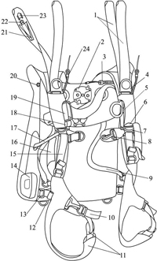
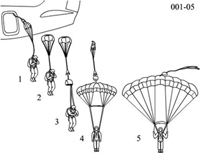

# «Лесник-3»: устройство и органы управления — основа для 3D-модели

Свод для 3D-модели с подписями и анимации ввода запасного парашюта, по образцу
спортивной анимации отцепки. Рядом дано сравнение со спортивной системой.

**Источник.** Система парашютная специального назначения «Лесник-3». Техническое описание
и инструкция по эксплуатации **216-01ТО**. Текст и рисунки взяты из копии на сайте
авиабазы охраны лесов (airbase.forest.ru, архив web.archive.org за 15.10.2009).
Ниже ссылки вида «ТО 1.4.4» указывают на раздел этого документа.

> ⚠️ Это интернет-копия ТО 2009 года, а не бумажный экземпляр. Перед выпуском анимации
> сверить с ТО и ИЭ, по которым работает учреждение: в поздних редакциях и на
> модификации «Лесник-3М» детали могут отличаться. Пункты, которых в ТО нет, помечены
> **[не из ТО]**.

---

## 1. Главное отличие от спортивной системы

| | Спортивная (AFF) | «Лесник-3» |
|---|---|---|
| Раскрытие основного | вытяжной парашют выбрасывает сам парашютист | после отделения **сразу** принудительно вводится **стабилизирующий парашют**; основной раскрывается кольцом через 5 с снижения на нём (ТО 1.2, 1.4) |
| Кольцо основного | вытяжная «медуза» в кармане на ранце | **кольцо звена ручного раскрытия ОП на левой лямке**, перед отделением его держат **правой рукой** (ТО 1.5.13, 3.2.1) |
| Отцепка основного | **отдельная подушка отцепки** справа, затем кольцо ПЗ слева: **два действия** | **одно действие**: кольцо ЗПС на **правой лямке** одновременно отцепляет основной (КЗУ) и раскрывает запасной (ТО 1.4.4, 3.3.2) |
| Запасной | крыло, ранец на спине | **тоже крыло**, купол идентичен основному (9 секций, 23 м²), стропы длиннее; **в нижнем отсеке того же ранца** на спине (ТО 1.5.10, 1.5.13) |
| Вытяжной запасного | пружинный | пружинный, 0,64 м² (ТО 1.5.1) |
| Страхующий прибор | Cypres, режет петлю ПЗ | **ППК-У-240АД**, открывает **двухконусный замок основного**, а не запасной (ТО 1.4.1, 1.5.13) |
| Управление | клеванты | звенья управления на задних свободных концах + **ленты-притяги (триммеры) на передних** (ТО 1.4.2, 1.4.3) |
| Снаряжение | комбинезон, шлем | СПП-3 с защитной сеткой; на подвесной системе крепится грузовой контейнер до 50 кг (ТО 1.2) |

Вывод для анимации: сцену «подушка справа, потом кольцо слева» из спортивной анимации
переносить нельзя. У «Лесника-3» **одно кольцо справа**, и оно делает всё.

---

## 2. Органы управления и что с ними делает пилот

Положение указано с точки зрения парашютиста (его левая и правая сторона).

| № | Орган | Где | Что делает | Кто и когда |
|---|---|---|---|---|
| 1 | **Кольцо звена ручного раскрытия ОП** (металлическая рамка + трос 0,63 м в гибком шланге) | карман на **левой** передней лямке | открывает **двухконусный замок** на спинке ранца, и стабилизирующий парашют вытягивает основной | **правой** рукой, левая лежит на правой, локти прижаты; рывок на всю длину руки после заданной задержки. Потом кольцо убрать в карман (ТО 1.5.17, 3.2.1) |
| 2 | **Кольцо звена ручного раскрытия ЗПС** (рамка, трос со шпилькой, на рамке скоба звена отсоединения) | карман на **правой** передней лямке | шпилька расчековывает отсек запасного; через скобу вытягиваются тросы отсоединения КЗУ, и основной отцепляется | любой рукой, на всю длину руки. Усилие не более 16 кгс (ТО 1.2, 1.5.18, 3.3) |
| 3 | **Звено отсоединения ОП**: тканевая основа на текстильной застёжке, ручка-втулка, два троса | **правая** лямка, на текстильной застёжке; тросы идут в двух боуденах (0,9 м к левой D-пряжке, 0,145 м к правой) | выдёргивает тросы из КЗУ, и свободные концы основного отсоединяются | в полёте срабатывает вместе с кольцом ЗПС. Отдельно им пользоваться ли, в ТО не сказано, см. вопросы (ТО 1.5.16, 1.5.19) |
| 4 | **КЗУ**: кольцевые замки свободных концов основного (большое кольцо, малое кольцо, петля, люверс) | внизу свободных концов основного, на **D-образных пряжках** передних лямок | соединяют основной купол с подвесной системой; расчековываются тросами звена отсоединения | — (ТО 1.5.7, рис. 1.8Б) |
| 5 | **Звенья управления ОП** (петля из ленты, люверс, верхняя и нижняя чека) | на **задних** свободных концах основного, стропы проходят через направляющие кольца | обе вниз: торможение; одна: разворот в её сторону; резко обе: «подрыв» | обеими руками, после наполнения сперва расчековать (ТО 1.4.2, 1.5.8) |
| 6 | **Ленты-притяги** (триммеры) с ручкой-чекой и шнуровой петлёй | на **передних** свободных концах основного | вниз: передний конец укорачивается, скорость растёт; фиксируются сами. Шнуровую петлю вверх: возврат | вернуть до высоты 100 м перед приземлением (ТО 1.4.3, 3.2.2) |
| 7 | **Звенья управления запасного** (петля, носик, люверс, текстильная застёжка) | на задних свободных концах **запасного**, которые образованы самими передними лямками | так же, как у основного | (ТО 1.5.11, 1.4.5) |
| 8 | **Страхующий прибор ППК-У-240АД** | карман на **правой** стороне ранца; шланг прибора идёт к двухконусному замку | через заданное время или на заданной высоте открывает двухконусный замок, то есть раскрывает **основной** | включается сам при натяжении соединительного звена стабилизации на отделении (ТО 1.4.1, 1.5.13) |
| 9 | **Карабин камеры стабилизирующего парашюта** | камера СП на ранце; на Ан-12, Ан-26, Ил-76 и Ми-8 её снимают и цепляют за трос ПРП | обеспечивает принудительный ввод стабилизирующего парашюта | цепляется в самолёте до отделения (ТО 1.5.2, 3.2.1) |
| 10 | **Нож-стропорез** | карман в декоративном клапане кармана кольца ОП, **левая** лямка | — | — (ТО 1.5.13) |

**Подвесная система** (ТО 1.5.13, рис. 1.13): две регулируемые передние лямки; их
верх — это свободные концы запасного. Кроме того: ножные обхваты с предохранителями,
поясные притяги, грудная перемычка (карабин слева, пряжка справа), притяги
стабилизации. На лямках стоят пряжки верхних карабинов грузового контейнера и звенья
спускового устройства, на спинке — пряжки нижних карабинов контейнера.

**Ранец** (ТО 1.5.13, рис. 1.14): два отсека — **верхний под основной** (в камере),
**нижний под запасной** (в чехле). Между окнами пластины жёсткости в верхнем отсеке
стоит двухконусный замок. Справа — карман прибора и карман слабины соединительного
звена.

Подписи к рис. 1.13 (ТО 1.5.13): 1 — свободный конец ПЗ; 2 — двухконусный замок;
3 — шланг звена ручного раскрытия ОП; 4 — D-образная пряжка монтажа КЗУ основного
парашюта; 5 — карман звена ручного раскрытия ОП; 6 — карман для ножа; 7 — верхняя пряжка
крепления контейнера; 8 — карабин грудной перемычки; 9 — притяг стабилизации; 10 — ножной
обхват; 11 — предохранитель ножного обхвата с удлинителем; 12 — нижняя пряжка крепления
контейнера; 13 — поясной притяг; 14 — карман ППК-У; 15 — передняя лямка; 16 — предохранитель
передней лямки; 17 — звено крепления спускового устройства; 18 — звено отсоединения;
19 — карман звена ручного раскрытия ПЗ; 20 — кольцо контровки фала гибкой шпильки;
21 — текстильная застёжка; 22 — направляющее кольцо стропы управления; 23 — шлевка фиксации
звена управления; 24 — шланг-боуден звена отсоединения.

---

## 3. Купола и стабилизация — для модели

- **Основной**: 9 секций, 23 м², прямоугольный, с удлинённой средней частью, ткань F-111.
  Четыре ряда строп, длина 1-го ряда 3,45 м. Перепады длин до 2-го, 3-го и 4-го рядов:
  0,10 / 0,26 / 0,56 м. На стропах устройство рифления 0,58×0,75 м с кольцами по углам.
  Боковые стабилизирующие полотнища. Сверху на центральной секции — кольцо
  ограничительного звена (ТО 1.5.5, 1.5.6).
- **Запасной**: такой же купол, длина 1-го ряда 4,9 м, стропы управления 4,28 м. Уложен в
  чехол, чехол уходит вместе с вытяжным (ТО 1.5.10, 1.5.12).
- **Стабилизирующий парашют**: бесстропный, 1,2 м², со стабилизатором (перьями) и
  соединительным звеном. На звене стоят силовой треугольник с пряжками под двухконусный
  замок и шпилька, которая замыкает отсек основного. Складывающая стропа идёт через
  камеру ОП к вершине СП (ТО 1.5.4, рис. 1.5).
- **Вытяжной пружинный** запасного: 0,64 м², коническая пружина (ТО 1.5.1).

Характеристики (ТО 1.2): полётная масса 60–150 кг; высота применения 400–4000 м;
скорость ЛА 140–350 км/ч; снижение до 5 м/с; горизонтальная скорость не менее 10,5 м/с;
разворот на 360° до 8 с. Минимальная безопасная высота — 600 м с задержкой 5 с,
запасного при немедленном вводе — 150 м. Ветер у земли — до 12 м/с.

---

## 4. Сцены для анимации

### 4.1. Нормальное раскрытие (ТО 1.4.1, рис. 1.1; 3.2.1)

1. В самолёте: карабин камеры СП зацеплен за трос ПРП или за удлинитель на Ан-2.
   Правая рука на кольце ОП (левая лямка), левая рука поверх правой, локти прижаты.
2. Отделение. Камера остаётся на тросе, **стабилизирующий парашют** вытягивается и
   наполняется. Натяжение звена включает **ППК-У**.
3. Стабилизированное снижение, **5 с** отсчёта. Отсек основного закрыт.
4. Рывок кольца ОП на всю длину руки. Трос открывает **двухконусный замок**.
5. Стабилизирующий парашют вытягивает **камеру с основным** из верхнего отсека.
   Стропы выходят из петель и сот, купол выходит из камеры.
6. Складывающая стропа втягивает вершину СП, и **стабилизирующий парашют складывается**.
7. Купол наполняется, преодолевая сопротивление **рифления**: рифление сползает к
   свободным концам.
8. Через 3–5 с — контроль купола. Если рифление не сошло, 2–3 раза втянуть стропы
   управления. Кольцо убрать в карман на лямке. Расчековать звенья управления.

Подписи (ТО 1.4.1): 1 — ввод стабилизирующего парашюта; 2 — снижение на стабилизирующем
парашюте; 3 — вытягивание камеры с куполом; 4 — наполнение парашюта; 5 — планирующий
спуск.

### 4.2. Отказ и ввод запасного (ТО 1.4.4; 3.3)

Все действия по исправлению основного — **до 600 м**. Дальше немедленно запасной.

- **Полный отказ**, в том числе **неотход стабилизирующего парашюта** (основной не вышел):
  выдернуть кольцо ЗПС на правой лямке на всю длину руки.
- **Частичный отказ**: основной не вышел из камеры, не наполнился, не сошло рифление,
  запутаны стропы, перехлёст, обрыв строп, порыв купола и т.п. Выдернуть **то же кольцо
  ЗПС**: вместе с его тросом выдёргиваются тросы КЗУ, основной отцепляется, и запасной
  вводится в действие.
- **Закрутка строп** при нормальном куполе: свести свободные концы и вращением тела
  раскрутиться. Запасной не нужен.

Сцена ввода запасного:

1. Отказ основного (например, перехлёст) — купол над головой работает неправильно.
2. Взгляд на правую лямку, рука на кольцо ЗПС.
3. Рывок на всю длину руки. **Одновременно**:
   - тросы отсоединения выходят из КЗУ на обеих D-пряжках, свободные концы основного
     уходят вверх вместе с куполом и стабилизирующим парашютом;
   - шпилька выходит из петли нижнего отсека, клапаны раскрываются.
4. **Пружинный вытяжной** выпрыгивает в поток, вытягивает чехол с запасным, стропы
   выходят из газырей и сот, чехол сходит с купола.
5. Запасной наполняется через рифление. Чехол с вытяжным улетают отдельно.
6. Расчековать звенья управления запасного (на текстильной застёжке задних концов
   лямок) и управлять, как основным.

---

## 5. Управление и приземление — для подписей (ТО 3.2.2, 3.2.3)

- **Обе стропы вниз**: горизонтальная скорость падает пропорционально ходу. До упора на
  1–3 с: вертикальная падает до 2 м/с. Дольше: вертикальная растёт до 6 м/с и выше
  (срыв).
- **Одна стропа или один свободный конец**: разворот в ту сторону. 360° за время до 8 с
  с креном и потерей до 35 м.
- **Передние свободные концы и ленты-притяги**: ускорение, но растёт и вертикальная
  скорость. Вернуть до 100 м.
- **Заход**: после наполнения войти в створ ветра, снижаться до 350 ± 50 м. На 100–150 м
  быть против ветра лицом к цели, стропы втянуты до ключиц. С 25–30 м отпустить, на
  3–6 м добрать на полную длину рук (при ветре 0–3 м/с).
- **После касания**: стропы вверх, затем энергично втянуть одну, развернуться на 180°
  в её сторону и погасить купол, забегая за него.

---

## 6. Чего в ТО нет — нужно от заказчика или из других документов

1. **Защитная сетка СПП-3** (опустить перед отделением, поднять после раскрытия, по
   программе УТВ). Её устройство — в отдельном ТО на СПП-3 **[не из ТО]**. Для модели
   нужна фотография или схема снаряжения.
2. **Можно ли отцепиться одним звеном отсоединения, без запасного** (на земле при сильном
   ветре, при зависании на дереве). ТО называет это звено, но порядок его отдельного
   применения не описан.
3. **Вид ранца и цвета**: рисунки ТО — штриховые схемы шириной 200 пикселей. Для
   правдоподобной модели нужны фотографии реальной системы со всех сторон, в первую
   очередь передние лямки с кольцами.
4. **Какая модификация у заказчика**: «Лесник-3» или «Лесник-3М» (у 3М купол 27 м²).
   От этого зависит размер купола в модели.

Рисунки ТО (1.1–1.21, 3.1–3.4) лежат в `glavpryg-sayt/lesnik-3/ris/`.
