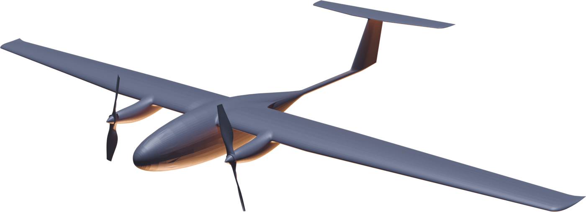

# «33» — выбор двигателя

<section class="dv slide oblozhka odin sinii">

Проект «33» · сравнение силовых установок · ноябрь 2026

<h1>«33» — какой двигатель выбрать</h1>

Электрический, ДВС с инжектором на бензине, ДВС на керосине и реактивный — на одном планере «33» с взлётной массой 24 кг

<b>электро</b>как в справке

<b>бензин</b>ДВС, инжектор

<b>керосин</b>ДВС, тяжёлое топливо

<b>реактив</b>малый ТРД

</section>

<section class="dv slide">

1 · Четыре варианта

<h2>Что ставим на «33»</h2>

<b class="im">Электрический</b>
Два электродвигателя по 1,4 кВт, аккумуляторы в корне крыла — как в справке.

<dl><dt>Установка</dt><dd>≈ 1,0 кг</dd><dt>Энергия</dt><dd>≈ 13 кг аккумуляторов</dd><dt>Заправка</dt><dd>зарядка 2–4 ч или замена</dd></dl>

тихий, без вибраций и выхлопа, проще всех в обслуживании

мощность не падает с высотой

дальность ограничена аккумулятором

боится мороза

<b class="im">ДВС с инжектором, бензин</b>
Двухтактный двигатель 50–100 см³ с впрыском топлива, генератор для борта.

<dl><dt>Установка</dt><dd>≈ 3,2 кг</dd><dt>Энергия</dt><dd>до 10,8 кг бензина (14,6 л)</dd><dt>Заправка</dt><dd>минуты</dd></dl>

дальность и время в разы больше

генератор питает тяжёлую нагрузку

шум, вибрации, выхлоп

ресурс до переборки 200–300 ч

<b class="im">ДВС на керосине</b>
Двигатель на тяжёлом топливе (керосин ТС-1, дизель) с впрыском.

<dl><dt>Установка</dt><dd>≈ 4,0 кг</dd><dt>Энергия</dt><dd>до 10 кг керосина (12,5 л)</dd><dt>Заправка</dt><dd>минуты</dd></dl>

одно топливо с авиацией и флотом

керосин безопаснее хранить

тяжелее и дороже бензинового

трудный запуск на морозе

<b class="im">Реактивный</b>
Малый турбореактивный двигатель тягой 40–60 Н, керосин.

<dl><dt>Установка</dt><dd>≈ 2,5 кг</dd><dt>Энергия</dt><dd>до 11,5 кг керосина (14,4 л)</dd><dt>Заправка</dt><dd>минуты</dd></dl>

высокая скорость — на другом крыле

проще всех по устройству

расход топлива в 15 раз выше ДВС

очень шумный и дорогой час полёта

Массы установок и расходы — оценка по открытым данным двигателей такого размера. Бензин и керосин разведены: у них разные двигатели, заказчики и условия хранения топлива.

</section>

<section class="dv slide">

2 · Как считали

<h2>Один планер — разная начинка</h2>

<h4>Из чего складываются 24 кг <small>— взлётная масса, кг</small></h4>

Электро

планер 8,5

1

аккумуляторы 13

1,5

Бензин

планер 8,5

ДВС 3,2

бензин 10,8

1,5

Керосин

планер 8,5

ДВС 4,0

керосин 10

1,5

Реактив

планер 8,5

2,5

керосин 11,5

1,5

планер, борт, парашютсиловая установкацелевая нагрузка

<h3>Допущения</h3>
<ul class="zadachi">
<li>Планер, крыло и взлётная масса 24 кг — как в справке; меняется только двигатель и запас энергии.</li>
<li>Аэродинамика подогнана под заявленные 800 км электрической версии. Не подтвердят испытания — все дальности снизятся в той же доле.</li>
<li>Аккумулятор — 230 Вт·ч/кг; расход бензинового ДВС на малом газе — 0,65 кг/кВт·ч, керосинового — 0,8, ТРД — 0,25 кг/Н·ч.</li>
<li>Питание нагрузки не учтено ни у кого — как в справке.</li>
</ul>

Проверка порядка цифр: Aerosonde массой 13,1 кг в 1998 году перелетел Атлантику — 3270 км за 26 ч 45 мин на ≈ 4 кг бензина (ctie.monash.edu). Расчёт — <code>dvigateli/raschet.py</code> в каталоге проекта.

</section>

<section class="dv slide">

3 · Дальность и время в воздухе

<h2>Топливо даёт в 4–9 раз больше</h2>

▮ сплошная — бак ≈ 7 л (сколько, скорее всего, поместится в «33»)▯ светлая — предел по массе: всё свободное — топливо▨ штриховка — цель из справки

<h4>Дальность <small>— км, крейсер 95 км/ч (реактив — 150 км/ч), нагрузка 1,5 кг</small></h4>

Электро

800 <small>цель 1200</small>

Бензин

3 850 <small>до 7 000</small>

Керосин

3 200 <small>до 5 100</small>

Реактив

360 <small>до 710</small>

<h4>Время в воздухе <small>— часы</small></h4>

Электро

9 <small>цель 12–14</small>

Бензин

40 <small>до 73</small>

Керосин

34 <small>до 54</small>

Реактив

2,4 <small>до 4,7</small>

<b>Почему так.</b> Килограмм бензина несёт в 50 раз больше энергии, чем килограмм аккумулятора; даже с КПД маленького ДВС ≈ 13 % на винт доходит в 8–9 раз больше. Керосиновый ДВС тяжелее и прожорливее бензинового — минус ≈ 25 % (так было при переводе ScanEagle на тяжёлое топливо, flightglobal.com).

<b>Реактивный на этом планере проигрывает даже электричке:</b> «33» летает медленно, а малый ТРД на малом газе тратит топливо впустую — ≈ 2,3 кг/ч против 0,14 кг/ч у бензинового ДВС.

Разброс по расходу топлива: бензин 5 000–8 200 км, керосин 4 100–5 900 км, реактив 510–850 км при полном баке. Ветер, набор высоты и резерв в расчёт не входят — на практике дальность у всех ниже.

</section>

<section class="dv slide">

4 · Скорость и высота

<h2>Скорость упирается в крыло, а не в двигатель</h2>

<h4>Наибольшая скорость <small>— км/ч</small></h4>

Электро

170 <small>справка</small>

Бензин

≈ 175

Керосин

≈ 170

Реактив

≈ 200 <small>новое крыло — 350–450</small>

Пунктир — предел планера «33», ≈ 200 км/ч (скорее всего; проверяется расчётом на прочность и флаттер — опасные колебания крыла). Шкала до 450 км/ч.

<h4>Практический потолок <small>— м</small></h4>

Электро

7 500

Бензин

5 000–6 500

Керосин

5 000–6 500

Реактив

6 000–7 500

У ДВС без наддува мощность на 7 500 м — меньше половины, у ТРД тяга тоже падает. Электродвигателю высота не мешает. Значения ДВС и ТРД — оценка. Шкала до 10 000 м.

<table class="sravnenie" style="margin-top:2mm">
<thead><tr><th class="param">Скорость, км/ч</th><th class="p33" style="width:18%">Электро</th><th class="p33" style="width:18%">Бензин</th><th class="p33" style="width:18%">Керосин</th><th class="drk">Реактив</th></tr></thead>
<tbody>
<tr><td>Крейсерская (экономичная)</td><td class="z">95</td><td class="z">95</td><td class="z">95</td><td class="z">130–150 — медленнее ТРД расходует ещё больше</td></tr>
<tr><td>Сваливания</td><td class="z">59 справка</td><td class="z">≈ 59</td><td class="z">≈ 59</td><td class="z">≈ 59 — на новом крыле выше</td></tr>
</tbody>
</table>
</section>

<section class="dv slide">

5 · Работа в разных температурах

<h2>Мороз бьёт по аккумулятору, жара — по двигателю</h2>

<h4>Диапазон работы <small>— °C, оценка по типовым данным</small></h4>

Электро

нет

подогрев и утепление аккумуляторов

штатно

охлаждение

Бензин

подогрев перед запуском

штатно

перегрев

Керосин

запуск со свечами накала и подогревом

штатно

Реактив

АКБ запуска

штатно

тяга −10 %

−50−30−100+20+40+50

штатнос мерамине рекомендуется

<table class="sravnenie plotnee">
<thead><tr><th class="param">Что происходит</th><th class="p33" style="width:19%">Электро</th><th class="p33" style="width:19%">Бензин</th><th class="p33" style="width:19%">Керосин</th><th class="drk">Реактив</th></tr></thead>
<tbody>
<tr><td>Дальность при −20 °C</td><td class="z">≈ 600 км (−25 %) без подогрева</td><td class="z">почти без потерь</td><td class="z">почти без потерь</td><td class="z">почти без потерь</td></tr>
<tr><td>Топливо на морозе</td><td>—</td><td>не замерзает; на холоде хуже испаряется — нужен подогрев</td><td>ТС-1 не мутнеет до −60 °C; запуск труднее бензина</td><td>тот же керосин; запуск обычный</td></tr>
<tr><td>Жара +40…+45 °C</td><td>нагрев аккумуляторов на наборе высоты</td><td>перегрев, пузыри пара в топливе</td><td>перегрев, но топливо устойчиво</td><td>тяга ниже на 10–15 %</td></tr>
<tr><td>Безопасность хранения</td><td>аккумуляторы — риск возгорания при повреждении</td><td>бензин вспыхивает уже при −40 °C</td><td>керосин — только от +28 °C и выше: пригоден для кораблей</td><td>как керосин</td></tr>
</tbody>
</table>
</section>

<section class="dv slide">

6 · Стоимость

<h2>Электрический час — самый дешёвый</h2>

<h4>Комплект: двигатель + запас энергии <small>— тыс. ₽</small></h4>

Электро

250–450 <small>с аккумуляторами</small>

Бензин

250–500

Керосин

600–1 200

Реактив

300–700 <small>+ новое крыло</small>

Шкала до 1 400 тыс. ₽. Светлая часть — разброс цен между поставщиками.

<h4>Час полёта: топливо + износ <small>— ₽</small></h4>

Электро

100–150

Бензин

650–950

Керосин

1 500–2 500

Реактив

2 500–3 500

Шкала до 4 200 ₽. Топливо в часе — копейки (бензин ≈ 15 ₽/ч), главное — износ двигателя.

<table class="sravnenie">
<thead><tr><th class="param">Из чего цена</th><th class="p33" style="width:19%">Электро</th><th class="p33" style="width:19%">Бензин</th><th class="p33" style="width:19%">Керосин</th><th class="drk">Реактив</th></tr></thead>
<tbody>
<tr><td>Ресурс</td><td>аккумулятор 300–500 циклов, двигатели — более 1000 ч</td><td>200–300 ч до переборки</td><td>150–300 ч до переборки</td><td>осмотр через 25–50 ч, ресурс ≈ 300 ч</td></tr>
<tr><td>Энергия на 100 км</td><td class="z">≈ 3 ₽ электричество</td><td class="z">≈ 15 ₽ 0,15 кг</td><td class="z">≈ 15 ₽ 0,19 кг</td><td class="z">≈ 120 ₽ 1,5 кг</td></tr>
<tr><td>Переделка планера</td><td>не нужна</td><td>моторама, бак, виброразвязка, выхлоп</td><td>то же, плюс подогрев для запуска</td><td>новое крыло и хвост под скорость</td></tr>
</tbody>
</table>

Цены — оценка по рынку 2026 года, порядок величин. Ресурс ТРД — по аналогии с заявленным UEC для малых ТРД: 100 ч между ремонтами, 300 ч всего (edrmagazine.eu).

</section>

<section class="dv slide">

7 · Полезная нагрузка · масса и питание

<h2>ДВС меняет топливо на нагрузку без больших потерь</h2>

<h4>Дальность при разной нагрузке <small>— км, взлётная 24 кг</small></h4>

электробензинкеросинреактив

<b>1,5 кг</b>

800

6 970

5 140

710

<b>3 кг</b>

710

5 780

4 200

610

<b>5 кг</b>

585

4 310

3 060

485

Шкала до 8 500 км. Нагрузка сверх 1,5 кг — за счёт энергии; топлива при этом 6–9 л, оно уже помещается в объём.

<h3 style="font-size:11pt">Сутки в воздухе — сколько можно взять</h3>
<table class="sravnenie odin uzk" style="font-size:8.6pt">
<tbody>
<tr><td>Электро</td><td class="z">не достигается — предел ≈ 9 ч</td></tr>
<tr><td>Бензин</td><td class="z">до 8 кг по массе; по объёму и центровке, скорее всего, 4–5 кг</td></tr>
<tr><td>Керосин</td><td class="z">до 6,5 кг по массе; реально 3–4 кг</td></tr>
<tr><td>Реактив</td><td class="z">не достигается — предел ≈ 6,5 ч без нагрузки</td></tr>
</tbody>
</table>

<h3 style="font-size:11pt;color:var(--tyomnyy)">Питание нагрузки</h3>
<table class="sravnenie odin uzk" style="font-size:8.6pt">
<tbody>
<tr><td>Электро</td><td>сколько угодно из основного аккумулятора, но каждые 100 Вт отнимают ≈ четверть дальности</td></tr>
<tr><td>Бензин</td><td>генератор 100–300 Вт; 100 Вт съедают ≈ треть дальности — запас большой</td></tr>
<tr><td>Керосин</td><td>генератор 100–300 Вт, как у бензина</td></tr>
<tr><td>Реактив</td><td>генератора обычно нет — отдельный аккумулятор, десятки ватт</td></tr>
</tbody>
</table>

</section>

<section class="dv slide">

7 · Полезная нагрузка · что с чем работает

<h2>Какая нагрузка на каком двигателе</h2>
<table class="sravnenie matr plotnee">
<thead><tr><th class="param">Нагрузка</th><th class="el">Электро</th><th class="bz">Бензин</th><th class="ks">Керосин</th><th class="rd">Реактив</th></tr></thead>
<tbody>
<tr class="gruppa"><td colspan="5">Из справки</td></tr>
<tr><td>Камера для ортофотосъёмки</td><td>отличнонет вибраций</td><td>можнонужна виброразвязка</td><td>можното же</td><td>можносмаз на скорости, мало времени</td></tr>
<tr><td>Выдвижная обзорная камера</td><td>отличнотихо, цель не слышит</td><td>можнослышно издалека</td><td>можното же</td><td>ограниченноскорость, шум</td></tr>
<tr><td>SAR (радиолокатор)</td><td>ограниченнопитание за счёт дальности</td><td>отличногенератор, масса</td><td>отличното же</td><td>ограниченнонет генератора</td></tr>
<tr><td>Ретранслятор радиосигнала</td><td>можнодо 9 ч</td><td>отличносутки и больше</td><td>отличносутки и больше</td><td>ограниченнонесколько часов</td></tr>
<tr><td>Бортовой газоанализатор</td><td>отличнонет своего выхлопа</td><td>ограниченносвой выхлоп портит замер — забор воздуха в носу</td><td>ограниченното же</td><td>не подходитвыхлоп и скорость</td></tr>
<tr><td>Бортовой радиометр</td><td>отлично</td><td>отличнодольше висит над районом</td><td>отлично</td><td>можнона скорости меньше точность</td></tr>
<tr class="gruppa"><td colspan="5">Дополнительно — что открывает ДВС</td></tr>
<tr><td>Тепловизор</td><td>отлично</td><td>можногорячий двигатель вне кадра</td><td>можно</td><td>ограниченногорячая струя</td></tr>
<tr><td>Лидар (лазерный сканер рельефа)</td><td>ограниченномасса 1,5–3 кг и питание</td><td>отлично</td><td>отлично</td><td>ограниченно</td></tr>
<tr><td>Сброс грузов 3–5 кг</td><td>ограниченно−25 % дальности</td><td>отличноаптечки, буи, датчики</td><td>отлично</td><td>не подходит</td></tr>
</tbody>
</table>

Оценка по устройству двигателей и требованиям нагрузки; конкретные модели нагрузки проверяются по массе и питанию.

</section>

<section class="dv slide">

8 · Сводная таблица

<h2>Всё рядом</h2>
<table class="sravnenie matr">
<thead><tr><th class="param">Показатель</th><th class="el">Электро</th><th class="bz">Бензин</th><th class="ks">Керосин</th><th class="rd">Реактив на «33»</th></tr></thead>
<tbody>
<tr><td>Дальность, км</td><td>800 (цель 1200)</td><td>3 850до 7 000</td><td>3 200 до 5 100</td><td>360 до 710</td></tr>
<tr><td>Время в воздухе, ч</td><td>9 (цель 12–14)</td><td>40до 73</td><td>34 до 54</td><td>2,4 до 4,7</td></tr>
<tr><td>Наибольшая скорость, км/ч</td><td>170</td><td>≈ 175</td><td>≈ 170</td><td>≈ 200новое крыло 350–450</td></tr>
<tr><td>Потолок, м</td><td>7 500</td><td>5 000–6 500</td><td>5 000–6 500</td><td>6 000–7 500</td></tr>
<tr><td>Мороз −30 °C</td><td>с подогревом</td><td>подогрев перед запуском</td><td>трудный запуск</td><td>штатно</td></tr>
<tr><td>Жара +45 °C</td><td>охлаждение</td><td>перегрев</td><td>штатно</td><td>тяга −10 %</td></tr>
<tr><td>Нагрузка на сутки полёта</td><td>нет</td><td>4–5 кг</td><td>3–4 кг</td><td>нет</td></tr>
<tr><td>Комплект, тыс. ₽</td><td>250–450</td><td>250–500</td><td>600–1 200</td><td>300–700 + крыло</td></tr>
<tr><td>Час полёта, ₽</td><td>100–150</td><td>650–950</td><td>1 500–2 500</td><td>2 500–3 500</td></tr>
<tr><td>Шум и заметность</td><td>тихий</td><td>шумный</td><td>шумный</td><td>очень шумный, горячий</td></tr>
<tr><td>Подготовка к вылету</td><td>зарядка 2–4 ч</td><td>заправка, прогрев</td><td>заправка, подогрев</td><td>заправка, запуск</td></tr>
<tr><td>Переделка планера</td><td>не нужна</td><td>умеренная</td><td>умеренная</td><td>новое крыло</td></tr>
</tbody>
</table>

Зелёным — лучший в строке. Дальность и время: бак ≈ 7 л / предел по массе. Всё, кроме данных справки по электрической версии, — оценка.

</section>

<section class="dv slide">

9 · Главное применение

<h2>У каждого варианта — своя работа</h2>

<b class="im">Электро</b>
Регулярные работы рядом с людьми: дёшево, тихо, чисто

<ul><li>картография и кадастр</li><li>экология: газоанализ без своего выхлопа</li><li>радиационный контроль</li><li>леса — дневной патруль</li><li>скрытное наблюдение</li></ul>

Не для: суток в воздухе, северных зим без подогрева.

<b class="im">Бензин</b>
Дальние и долгие задачи коммерческих заказчиков

<ul><li>трубопроводы и ЛЭП на тысячи километров</li><li>ретранслятор связи сутками</li><li>охрана границ и периметров</li><li>SAR и лидар — тяжёлая нагрузка</li><li>Арктика: аккумулятор не мёрзнет</li></ul>

Не для: газоанализа, тихих работ, кораблей.

<b class="im">Керосин</b>
Там, где бензина нет или его нельзя держать

<ul><li>работа с кораблей: топливо не вспыхивает при обычной температуре</li><li>северные базы и аэродромы: ТС-1 есть везде</li><li>одно топливо с авиацией и флотом госзаказчика</li><li>ледовая разведка на Севморпути</li></ul>

Не для: дешёвого часа и частых морозных запусков без подогрева.

<b class="im">Реактивный</b>
Скорость — но на другом крыле

<ul><li>мишени для тренировки ПВО</li><li>быстрое прибытие к месту ЧС</li><li>скоростная разведка на короткие расстояния</li></ul>

На планере «33» не оправдан: дальность и время ниже электрической версии, час — самый дорогой. Это ниша «Твин Дракена».

</section>

<section class="dv slide">

10 · Вывод

<h2>Что выбрать для «33»</h2>

Основная версия
Электро — как сейчас

Самый дешёвый час и самое простое обслуживание. Подтвердить на испытаниях заявленные 800 км и 9 ч.

Вторая модификация
Бензин с инжектором — «дальняя» версия

Тот же планер, в 4–9 раз больше дальности, сутки в воздухе и тяжёлая нагрузка. Самый сильный ход для рынка 2027 года.

Под заказ
Керосин — для флота и государства

Делать, когда заказчику нужно одно топливо с его техникой или работа с корабля. Дороже бензиновой версии в 2–3 раза.

Не на этом планере
Реактивный — отдельный проект

Требует нового крыла. Скоростные задачи закрывает «Твин Дракен».

<b>Что проверить, прежде чем решать</b>
<ol>
<li>Лётные испытания электрической версии: реальная дальность определяет все цифры этого сравнения.</li>
<li>Объём под бак в планере: сколько литров поместится без нарушения центровки.</li>
<li>Выбор конкретного ДВС: масса, расход на малом газе, ресурс, поставка.</li>
<li>Вибрации и нагрузка на гондолы от ДВС: выдержит ли силовая схема.</li>
<li>Предельная скорость планера «33» — расчёт на прочность и флаттер.</li>
<li>Морозные испытания аккумуляторов электрической версии.</li>
</ol>

</section>
