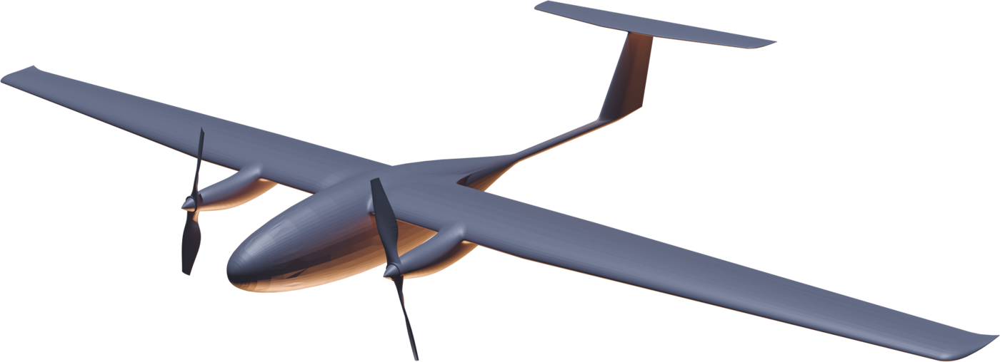

# «33» — выбор двигателя

<section class="dv slide oblozhka odin sinii">

Проект «33» · сравнение силовых установок · ноябрь 2026

<h1>«33» — какой двигатель выбрать</h1>

Электрический и ДВС с СЭВ инжектором на бензине и на керосине — на одном планере «33» с взлётной массой 24 кг

<b>электро</b>как в справке

<b>бензин</b>ДВС + СЭВ инжектор

<b>керосин</b>ДВС + СЭВ инжектор

</section>

<section class="dv slide">

1 · Три варианта

<h2>Что ставим на «33»</h2>

<b class="im">Электрический</b>
Два электродвигателя по 1,4 кВт, аккумуляторы в корне крыла — как в справке.

<dl><dt>Установка</dt><dd>≈ 1,0 кг</dd><dt>Энергия</dt><dd>≈ 13 кг аккумуляторов</dd><dt>Заправка</dt><dd>зарядка 2–4 ч или замена</dd></dl>

тихий, без вибраций и выхлопа, проще всех в обслуживании

мощность не падает с высотой

дальность ограничена аккумулятором

боится мороза

<b class="im">ДВС + СЭВ инжектор, бензин</b>
Двухтактный двигатель 50–100 см³ с нашим электронным впрыском СЭВ, генератор для борта.

<dl><dt>Установка</dt><dd>≈ 3,2 кг</dd><dt>Энергия</dt><dd>до 10,8 кг бензина (14,6 л)</dd><dt>Заправка</dt><dd>минуты</dd></dl>

дальность и время в разы больше

запуск за 45 с, без ручного обогатителя

генератор питает тяжёлую нагрузку

шум, вибрации, выхлоп

ресурс до переборки 200–300 ч

<b class="im">ДВС + СЭВ инжектор, керосин</b>
Двигатель на керосине ТС-1 с СЭВ инжектором — на керосине уже запускался.

<dl><dt>Установка</dt><dd>≈ 4,0 кг</dd><dt>Энергия</dt><dd>до 10 кг керосина (12,5 л)</dd><dt>Заправка</dt><dd>минуты</dd></dl>

одно топливо с авиацией и флотом

керосин безопаснее хранить

свой впрыск — без импортного двигателя на тяжёлом топливе

тяжелее бензинового, расход выше

на морозе — подогрев перед запуском

Массы установок и расходы — оценка по открытым данным двигателей такого размера. Бензин и керосин разведены: у них разные заказчики и условия хранения топлива. Впрыск у обоих — СЭВ инжектор.

</section>

<section class="dv slide">

2 · Наш впрыск

<h2>СЭВ инжектор — отечественный электронный впрыск для ДВС</h2>

300 <i>тыс. ₽</i>

блок + программа

на 55 % дешевле аналогов

−25 <i>%</i>

расход к карбюратору

дальность +25 %

45 <i>с</i>

запуск двигателя

карбюратор — 5–60 мин

+10 <i>%</i>

к мощности ДВС

1 <i>нед.</i>

срок поставки

сервис в России

2 <i>топлива</i>

бензин и керосин

на керосине уже запускался

<h4>Цена системы впрыска <small>— тыс. ₽</small></h4>

<b>СЭВ инжектор</b>

300 <small>Россия</small>

LUTAN

800 <small>Турция–Китай</small>

FlyEfi

1 000 <small>США</small>

SDS EFI

1 300 <small style="color:#fff">США / Канада</small>

<h3 style="font-size:11.5pt;margin-bottom:2mm">Что входит</h3>

Блок управления, настроенный под двигатель; жгут; дроссельный узел с холодным ходом и впрыском; модуль зажигания; топливная станция.

Установка на новый двигатель — 3–5 недель, с настройкой на стенде. Запуск без ручных манипуляций: смесь сама обогащается по прогреву.

Данные — презентация проекта «СЭВ-динамика» (стендовые испытания с замерами, испытания 2024 года). Цены аналогов — оттуда же.

</section>

<section class="dv slide">

2 · Что СЭВ даёт «33»

<h2>Карбюратор, импортный впрыск или СЭВ инжектор</h2>
<table class="sravnenie matr">
<thead><tr><th class="param">Для «33» на бензине</th><th style="background:var(--neytr2)">Карбюратор</th><th style="background:var(--neytr)">Импортный впрыск</th><th class="bz">СЭВ инжектор</th></tr></thead>
<tbody>
<tr><td>Дальность, бак ≈ 7 л</td><td>≈ 3 100 км</td><td>≈ 3 700 км расход −20 %</td><td>≈ 3 850 кмрасход −25 %</td></tr>
<tr><td>Время в воздухе</td><td>≈ 32 ч</td><td>≈ 39 ч</td><td>≈ 40 ч</td></tr>
<tr><td>Запуск</td><td>5–60 минпрогрев, ручной обогатитель</td><td>минуты</td><td>45 ссам обогащает смесь по прогреву</td></tr>
<tr><td>Надёжность</td><td>слабое местовероятность отказа — 80 % в сравнении с инжекторной</td><td>как у СЭВ</td><td>электронное управление</td></tr>
<tr><td>Высота и мороз</td><td>смесь сбиваетсяна высоте переобогащается</td><td>подстраивает смесь</td><td>подстраивает смесь+10 % мощности</td></tr>
<tr><td>Керосин</td><td>не годится</td><td>нужен отдельный двигатель на тяжёлом топливе</td><td>уже запускался</td></tr>
<tr><td>Цена системы</td><td>дёшево</td><td>800–1 300 тыс. ₽</td><td>300 тыс. ₽</td></tr>
<tr><td>Поставка и сервис</td><td>—</td><td>2 месяца или нет; сервиса в России нет</td><td>1 неделя, сервис в России</td></tr>
</tbody>
</table>

Проценты расхода, запуск, надёжность и цены — по данным «СЭВ-динамика»; дальность и время — пересчёт из расчёта этого документа. Для «33» СЭВ инжектор — ещё и витрина: свой впрыск на своём аппарате.

</section>

<section class="dv slide">

3 · Как считали

<h2>Один планер — разная начинка</h2>

<h4>Из чего складываются 24 кг <small>— взлётная масса, кг</small></h4>

Электро

планер 8,5

1

аккумуляторы 13

1,5

Бензин

планер 8,5

ДВС 3,2

бензин 10,8

1,5

Керосин

планер 8,5

ДВС 4,0

керосин 10

1,5

планер, борт, парашютсиловая установкацелевая нагрузка

<h3>Допущения</h3>
<ul class="zadachi">
<li>Планер, крыло и взлётная масса 24 кг — как в справке; меняется только двигатель и запас энергии.</li>
<li>Аэродинамика подогнана под заявленные 800 км электрической версии. Не подтвердят испытания — все дальности снизятся в той же доле.</li>
<li>Аккумулятор — 230 Вт·ч/кг; расход ДВС с СЭВ инжектором на малом газе — 0,65 кг/кВт·ч на бензине и 0,8 на керосине (с карбюратором — на 25 % больше).</li>
<li>Питание нагрузки не учтено ни у кого — как в справке.</li>
</ul>

Проверка порядка цифр: Aerosonde массой 13,1 кг в 1998 году перелетел Атлантику — 3270 км за 26 ч 45 мин на ≈ 4 кг бензина (ctie.monash.edu). Расчёт — <code>raschet.py</code> рядом с документом.

</section>

<section class="dv slide">

4 · Дальность и время в воздухе

<h2>Топливо даёт в 4–9 раз больше</h2>

▮ сплошная — бак ≈ 7 л (сколько, скорее всего, поместится в «33»)▯ светлая — предел по массе: всё свободное — топливо▨ штриховка — цель из справки

<h4>Дальность <small>— км, крейсер 95 км/ч, нагрузка 1,5 кг</small></h4>

Электро

800 <small>цель 1200</small>

Бензин

3 850 <small>до 7 000</small>

Керосин

3 200 <small>до 5 100</small>

<h4>Время в воздухе <small>— часы</small></h4>

Электро

9 <small>цель 12–14</small>

Бензин

40 <small>до 73</small>

Керосин

34 <small>до 54</small>

<b>Почему так.</b> Килограмм бензина несёт в 50 раз больше энергии, чем килограмм аккумулятора; даже с КПД маленького ДВС ≈ 13 % на винт доходит в 8–9 раз больше. Керосиновый ДВС тяжелее и прожорливее бензинового — минус ≈ 25 % (так было при переводе ScanEagle на тяжёлое топливо, flightglobal.com).

С карбюратором вместо СЭВ инжектора бензиновая версия пролетела бы ≈ 3 100 км вместо 3 850 (расход на 25 % выше). Разброс по расходу топлива: бензин 5 000–8 200 км, керосин 4 100–5 900 км при полном баке. Ветер, набор высоты и резерв в расчёт не входят — на практике дальность у всех ниже.

</section>

<section class="dv slide">

5 · Скорость и высота

<h2>Скорость одна — потолок разный</h2>

<h4>Наибольшая скорость <small>— км/ч</small></h4>

Электро

170 <small>справка</small>

Бензин

≈ 180

Керосин

≈ 170

Скорость у всех упирается в планер «33»: крыло сделано под 95–170 км/ч. +10 % мощности СЭВ дают ≈ +3 % скорости. Шкала до 200 км/ч.

<h4>Практический потолок <small>— м</small></h4>

Электро

7 500

Бензин

5 500–7 000

Керосин

5 500–7 000

У ДВС без наддува мощность на 7 500 м — меньше половины; СЭВ инжектор сам подстраивает смесь под высоту, карбюратор так не умеет. Электродвигателю высота не мешает. Значения ДВС — оценка. Шкала до 10 000 м.

<table class="sravnenie" style="margin-top:2mm">
<thead><tr><th class="param">Скорость, км/ч</th><th class="p33" style="width:18%">Электро</th><th class="p33" style="width:18%">Бензин</th><th class="p33" style="width:18%">Керосин</th></tr></thead>
<tbody>
<tr><td>Крейсерская (экономичная)</td><td class="z">95</td><td class="z">95</td><td class="z">95</td></tr>
<tr><td>Сваливания</td><td class="z">59 справка</td><td class="z">≈ 59</td><td class="z">≈ 59</td></tr>
</tbody>
</table>
</section>

<section class="dv slide">

6 · Работа в разных температурах

<h2>Мороз бьёт по аккумулятору, жара — по двигателю</h2>

<h4>Диапазон работы <small>— °C, оценка по типовым данным</small></h4>

Электро

нет

подогрев и утепление аккумуляторов

штатно

охлаждение

Бензин

подогрев

штатно — СЭВ сам обогащает смесь

перегрев

Керосин

подогрев перед запуском

штатно — запуск с СЭВ подтверждён

−50−30−100+20+40+50

штатнос мерамине рекомендуется

<table class="sravnenie plotnee">
<thead><tr><th class="param">Что происходит</th><th class="p33" style="width:19%">Электро</th><th class="p33" style="width:19%">Бензин</th><th class="p33" style="width:19%">Керосин</th></tr></thead>
<tbody>
<tr><td>Дальность при −20 °C</td><td class="z">≈ 600 км (−25 %) без подогрева</td><td class="z">почти без потерь</td><td class="z">почти без потерь</td></tr>
<tr><td>Топливо на морозе</td><td>—</td><td>не замерзает; СЭВ сам обогащает смесь по прогреву — без ручного обогатителя</td><td>ТС-1 не мутнеет до −60 °C; испаряется хуже бензина — в сильный мороз подогрев</td></tr>
<tr><td>Жара +40…+45 °C</td><td>нагрев аккумуляторов на наборе высоты</td><td>перегрев, пузыри пара в топливе</td><td>перегрев, но топливо устойчиво</td></tr>
<tr><td>Безопасность хранения</td><td>аккумуляторы — риск возгорания при повреждении</td><td>бензин вспыхивает уже при −40 °C</td><td>керосин — только от +28 °C и выше: пригоден для кораблей</td></tr>
</tbody>
</table>
</section>

<section class="dv slide">

7 · Стоимость

<h2>Электрический час — самый дешёвый</h2>

<h4>Комплект: двигатель + запас энергии <small>— тыс. ₽</small></h4>

Электро

250–450 <small>с аккумуляторами</small>

Бензин

380–500 <small>с СЭВ</small>

Керосин

450–700 <small>с СЭВ</small>

Шкала до 1 000 тыс. ₽. Светлая часть — разброс цен между поставщиками. Керосиновый ДВС с импортным впрыском — 600–1 200.

<h4>Час полёта: топливо + износ <small>— ₽</small></h4>

Электро

100–150

Бензин

400–650

Керосин

700–1 100

Шкала до 1 500 ₽. Топливо в часе — копейки (бензин ≈ 15 ₽/ч), главное — износ двигателя; СЭВ за 300 тыс. ₽ служит дольше двигателя и делится на его ресурс.

<table class="sravnenie">
<thead><tr><th class="param">Из чего цена</th><th class="p33" style="width:19%">Электро</th><th class="p33" style="width:19%">Бензин</th><th class="p33" style="width:19%">Керосин</th></tr></thead>
<tbody>
<tr><td>Ресурс</td><td>аккумулятор 300–500 циклов, двигатели — более 1000 ч</td><td>200–300 ч до переборки</td><td>150–300 ч до переборки</td></tr>
<tr><td>Энергия на 100 км</td><td class="z">≈ 3 ₽ электричество</td><td class="z">≈ 15 ₽ 0,15 кг</td><td class="z">≈ 15 ₽ 0,19 кг</td></tr>
<tr><td>Впрыск</td><td>—</td><td>СЭВ инжектор 300 тыс. ₽, поставка 1 неделя, установка 3–5 недель</td><td>то же; импортный двигатель на тяжёлом топливе не нужен</td></tr>
<tr><td>Переделка планера</td><td>не нужна</td><td>моторама, бак, виброразвязка, выхлоп</td><td>то же, плюс подогрев для запуска</td></tr>
</tbody>
</table>

Цены — оценка по рынку 2026 года, порядок величин; комплект ДВС = двигатель без впрыска (80–200 тыс. ₽ бензиновый, 150–400 тыс. ₽ под керосин) + СЭВ инжектор.

</section>

<section class="dv slide">

8 · Полезная нагрузка · масса и питание

<h2>ДВС меняет топливо на нагрузку без больших потерь</h2>

<h4>Дальность при разной нагрузке <small>— км, взлётная 24 кг</small></h4>

электробензинкеросин

<b>1,5 кг</b>

800

6 970

5 140

<b>3 кг</b>

710

5 780

4 200

<b>5 кг</b>

585

4 310

3 060

Шкала до 8 500 км. Нагрузка сверх 1,5 кг — за счёт энергии; топлива при этом 6–9 л, оно уже помещается в объём.

<h3 style="font-size:11pt">Сутки в воздухе — сколько можно взять</h3>
<table class="sravnenie odin uzk" style="font-size:8.6pt">
<tbody>
<tr><td>Электро</td><td class="z">не достигается — предел ≈ 9 ч</td></tr>
<tr><td>Бензин</td><td class="z">до 8 кг по массе; по объёму и центровке, скорее всего, 4–5 кг</td></tr>
<tr><td>Керосин</td><td class="z">до 6,5 кг по массе; реально 3–4 кг</td></tr>
</tbody>
</table>

<h3 style="font-size:11pt;color:var(--tyomnyy)">Питание нагрузки</h3>
<table class="sravnenie odin uzk" style="font-size:8.6pt">
<tbody>
<tr><td>Электро</td><td>сколько угодно из основного аккумулятора, но каждые 100 Вт отнимают ≈ четверть дальности</td></tr>
<tr><td>Бензин</td><td>генератор 100–300 Вт; 100 Вт съедают ≈ треть дальности — запас большой</td></tr>
<tr><td>Керосин</td><td>генератор 100–300 Вт, как у бензина</td></tr>
</tbody>
</table>

</section>

<section class="dv slide">

8 · Полезная нагрузка · что с чем работает

<h2>Какая нагрузка на каком двигателе</h2>
<table class="sravnenie matr plotnee">
<thead><tr><th class="param">Нагрузка</th><th class="el">Электро</th><th class="bz">Бензин</th><th class="ks" style="border-radius:0 2mm 0 0">Керосин</th></tr></thead>
<tbody>
<tr class="gruppa"><td colspan="4">Из справки</td></tr>
<tr><td>Камера для ортофотосъёмки</td><td>отличнонет вибраций</td><td>можнонужна виброразвязка</td><td>можното же</td></tr>
<tr><td>Выдвижная обзорная камера</td><td>отличнотихо, цель не слышит</td><td>можнослышно издалека</td><td>можното же</td></tr>
<tr><td>SAR (радиолокатор)</td><td>ограниченнопитание за счёт дальности</td><td>отличногенератор, масса</td><td>отличното же</td></tr>
<tr><td>Ретранслятор радиосигнала</td><td>можнодо 9 ч</td><td>отличносутки и больше</td><td>отличносутки и больше</td></tr>
<tr><td>Бортовой газоанализатор</td><td>отличнонет своего выхлопа</td><td>ограниченносвой выхлоп портит замер — забор воздуха в носу</td><td>ограниченното же</td></tr>
<tr><td>Бортовой радиометр</td><td>отлично</td><td>отличнодольше висит над районом</td><td>отлично</td></tr>
<tr class="gruppa"><td colspan="4">Дополнительно — что открывает ДВС</td></tr>
<tr><td>Тепловизор</td><td>отлично</td><td>можногорячий двигатель вне кадра</td><td>можно</td></tr>
<tr><td>Лидар (лазерный сканер рельефа)</td><td>ограниченномасса 1,5–3 кг и питание</td><td>отлично</td><td>отлично</td></tr>
<tr><td>Сброс грузов 3–5 кг</td><td>ограниченно−25 % дальности</td><td>отличноаптечки, буи, датчики</td><td>отлично</td></tr>
</tbody>
</table>

Оценка по устройству двигателей и требованиям нагрузки; конкретные модели нагрузки проверяются по массе и питанию.

</section>

<section class="dv slide">

9 · Сводная таблица

<h2>Всё рядом</h2>
<table class="sravnenie matr">
<thead><tr><th class="param">Показатель</th><th class="el">Электро</th><th class="bz">Бензин</th><th class="ks" style="border-radius:0 2mm 0 0">Керосин</th></tr></thead>
<tbody>
<tr><td>Дальность, км</td><td>800 (цель 1200)</td><td>3 850до 7 000</td><td>3 200 до 5 100</td></tr>
<tr><td>Время в воздухе, ч</td><td>9 (цель 12–14)</td><td>40до 73</td><td>34 до 54</td></tr>
<tr><td>Наибольшая скорость, км/ч</td><td>170</td><td>≈ 180</td><td>≈ 175</td></tr>
<tr><td>Потолок, м</td><td>7 500</td><td>5 500–7 000</td><td>5 500–7 000</td></tr>
<tr><td>Мороз −30 °C</td><td>с подогревом</td><td>штатно, СЭВ</td><td>подогрев перед запуском</td></tr>
<tr><td>Жара +45 °C</td><td>охлаждение</td><td>перегрев</td><td>штатно</td></tr>
<tr><td>Нагрузка на сутки полёта</td><td>нет</td><td>4–5 кг</td><td>3–4 кг</td></tr>
<tr><td>Запуск</td><td>сразу</td><td>45 с, СЭВ</td><td>с СЭВ, подтверждён</td></tr>
<tr><td>Комплект, тыс. ₽</td><td>250–450</td><td>380–500</td><td>450–700</td></tr>
<tr><td>Час полёта, ₽</td><td>100–150</td><td>400–650</td><td>700–1 100</td></tr>
<tr><td>Шум и заметность</td><td>тихий</td><td>шумный</td><td>шумный</td></tr>
<tr><td>Подготовка к вылету</td><td>зарядка 2–4 ч</td><td>заправка, прогрев</td><td>заправка, подогрев</td></tr>
<tr><td>Переделка планера</td><td>не нужна</td><td>умеренная</td><td>умеренная</td></tr>
</tbody>
</table>

Зелёным — лучший в строке. Дальность и время: бак ≈ 7 л / предел по массе. Всё, кроме данных справки по электрической версии, — оценка.

</section>

<section class="dv slide">

10 · Главное применение

<h2>У каждого варианта — своя работа</h2>

<b class="im">Электро</b>
Регулярные работы рядом с людьми: дёшево, тихо, чисто

<ul><li>картография и кадастр</li><li>экология: газоанализ без своего выхлопа</li><li>радиационный контроль</li><li>леса — дневной патруль</li><li>скрытное наблюдение</li></ul>

Не для: суток в воздухе, северных зим без подогрева.

<b class="im">Бензин + СЭВ</b>
Дальние и долгие задачи коммерческих заказчиков

<ul><li>трубопроводы и ЛЭП на тысячи километров</li><li>ретранслятор связи сутками</li><li>охрана границ и периметров</li><li>SAR и лидар — тяжёлая нагрузка</li><li>Арктика: аккумулятор не мёрзнет</li></ul>

Не для: газоанализа, тихих работ, кораблей.

<b class="im">Керосин + СЭВ</b>
Там, где бензина нет или его нельзя держать

<ul><li>работа с кораблей: топливо не вспыхивает при обычной температуре</li><li>северные базы и аэродромы: ТС-1 есть везде</li><li>одно топливо с авиацией и флотом госзаказчика</li><li>ледовая разведка на Севморпути</li></ul>

Не для: газоанализа и тихих работ; в сильный мороз — подогрев.

</section>

<section class="dv slide">

11 · Гибрид — нужен ли

<h2>Гибрид: не четвёртая модификация, а способ сделать бензиновую</h2>
<table class="sravnenie matr plotnee">
<thead><tr><th class="param">«33» на бензине + СЭВ</th><th class="bz">Прямой привод: ДВС крутит винт</th><th class="ks" style="border-radius:0 2mm 0 0">Последовательный гибрид: ДВС + генератор, винты крутят электромоторы</th></tr></thead>
<tbody>
<tr><td>Дальность, бак ≈ 7 л</td><td>≈ 3 850 км≈ 40 ч</td><td>≈ 3 400 км 3 100–3 750; ≈ 35 ч</td></tr>
<tr><td>Нагрузка на сутки полёта</td><td>4–5 кгпо массе до 8</td><td>3–4 кг по массе до 5</td></tr>
<tr><td>Тихий режим</td><td>нет</td><td>≈ 1,8 ч / 175 кмДВС заглушён, летит на буфере</td></tr>
<tr><td>Газоанализ на дальней трассе</td><td>мешает выхлоп</td><td>можнозамер в тихом режиме</td></tr>
<tr><td>Отказ ДВС</td><td>только парашют</td><td>долетает на буфередо ≈ 175 км</td></tr>
<tr><td>Гондолы и винты</td><td>переделка под ДВСвибрации на крыле, два мотора или новая схема</td><td>как у электроодин ДВС в фюзеляже</td></tr>
<tr><td>Режим ДВС</td><td>малый газ — невыгодный</td><td>постоянный, выгодныйСЭВ держит режим, ресурс больше</td></tr>
<tr><td>Цена и сложность</td><td>проще</td><td>+150–300 тыс. ₽генератор, блок, буферный аккумулятор ≈ 2,5 кг</td></tr>
</tbody>
</table>

<b>Вывод: остаёмся на трёх модификациях — электро, бензин + СЭВ, керосин + СЭВ.</b>

Гибрид не даёт новой дальности: теряет ≈ 12 % на цепочке «генератор — электромотор» и везёт лишние ≈ 3 кг. Зато сохраняет гондолы и электромоторы «33», даёт тихий режим и запас на отказ двигателя. Это решение о том, <b>как устроить</b> топливные версии, — принять на прототипе: если ДВС в гондолы ставить трудно, бензиновая и керосиновая версии делаются гибридными. Отдельной модификацией — только под заказ «тихий долгий патруль».

Оценка: ДВС на выгодном режиме 0,45–0,55 кг/кВт·ч, цепочка ≈ 0,79, буферный аккумулятор 2,5 кг; та же модель, что у остальных версий.

</section>

<section class="dv slide">

12 · Вывод

<h2>Что выбрать для «33»</h2>

Основная версия
Электро — как сейчас

Самый дешёвый час и самое простое обслуживание. Подтвердить на испытаниях заявленные 800 км и 9 ч.

Вторая модификация
Бензин + СЭВ инжектор — «дальняя» версия

Тот же планер, в 4–9 раз больше дальности, сутки в воздухе, запуск за 45 с. Свой впрыск на своём аппарате — витрина для обоих проектов.

Под заказ
Керосин + СЭВ инжектор — для флота и государства

На керосине СЭВ уже запускался. Одно топливо с техникой заказчика, работа с корабля; без импортного двигателя на тяжёлом топливе — дешевле его почти вдвое.

<b>Что проверить, прежде чем решать</b>
<ol>
<li>Лётные испытания электрической версии: реальная дальность определяет все цифры этого сравнения.</li>
<li>Объём под бак в планере: сколько литров поместится без нарушения центровки.</li>
<li>Двигатель под СЭВ инжектор: масса, ресурс; настройка блока на стенде (3–5 недель) с замером расхода на малом газе — на бензине и на керосине.</li>
<li>Прямой привод или гибрид: выдержат ли гондолы ДВС и его вибрации — от этого зависит устройство топливных версий.</li>
<li>Предельная скорость планера «33» — расчёт на прочность и флаттер.</li>
<li>Морозные испытания аккумуляторов электрической версии.</li>
</ol>

</section>
