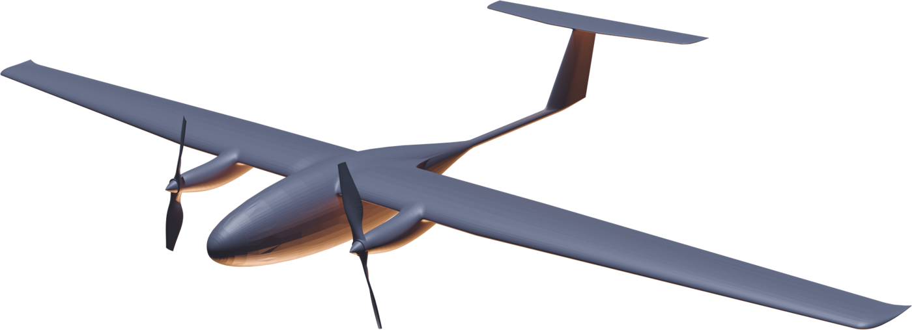

# «33» — применение по модификациям

<section class="dv slide oblozhka odin sinii">

Проект «33» · применение по модификациям · ноябрь 2026

<h1>«33» — какая версия для какой работы</h1>

Один планер, три силовые установки: электрическая, ДВС + СЭВ инжектор на бензине и на керосине. У каждой — своя работа

<b>электро</b>до 800 км · 9 ч

<b>бензин + СЭВ</b>≈ 3 850 км · 40 ч

<b>керосин + СЭВ</b>≈ 3 200 км · 34 ч

</section>

<section class="dv slide">

1 · Задача × модификация

<h2>Восемь направлений — кому что</h2>
<table class="sravnenie matr">
<thead><tr><th class="param">Направление</th><th class="el">Электро</th><th class="bz">Бензин + СЭВ</th><th class="ks">Керосин + СЭВ</th></tr></thead>
<tbody>
<tr><td>Трубопроводы, линейные объекты</td><td>подходитучастки до ≈ 340 км от точки взлёта</td><td>лучший выборучастки до ≈ 1 600 км за вылет</td><td>подходиттам, где есть только керосин</td></tr>
<tr><td>ЛЭП и энергосети</td><td>лучший выбортиповой обход — сотни км, час дешевле всех</td><td>подходитдля дальних магистралей</td><td>избыточно</td></tr>
<tr><td>Леса и пожары</td><td>подходитдневной патруль</td><td>лучший выборсутки над районом, тепловизор, связь для групп</td><td>подходит</td></tr>
<tr><td>Картография и кадастр</td><td>лучший выборнет вибраций — чёткий снимок</td><td>подходитбольшие площади, нужна виброразвязка</td><td>избыточно</td></tr>
<tr><td>Ретранслятор связи</td><td>до 9 чкороткие работы</td><td>лучший выборсутки с 4–5 кг нагрузки</td><td>лучший выборс кораблей и баз флота</td></tr>
<tr><td>Арктика, ледовая разведка</td><td>не подходитмороз отнимает дальность</td><td>подходитСЭВ запускает на морозе</td><td>лучший выборТС-1 на всех северных базах</td></tr>
<tr><td>Экология и радиация</td><td>лучший выборнет своего выхлопа для газоанализа</td><td>радиометр — да, газ — нет</td><td>радиометр — да, газ — нет</td></tr>
<tr><td>Охрана границ и периметров</td><td>подходиттихое наблюдение объектов</td><td>лучший выборсутки патруля, SAR на генераторе</td><td>лучший выборморские границы, единое топливо</td></tr>
</tbody>
</table>

Оценка по характеристикам документа «"33" — выбор двигателя». Участок трассы — половина дальности с запасом 15 %: туда и обратно с одной точки взлёта.

</section>

<section class="dv slide">

2 · Электро

<h2>Электро — регулярная работа рядом с людьми</h2>

<h3>Особенности</h3>
<dl><dt>Дальность</dt><dd>≥ 800 км (цель 1 200)</dd><dt>В воздухе</dt><dd>≥ 9 ч (цель 12–14)</dd><dt>Час полёта</dt><dd>100–150 ₽</dd><dt>Нагрузка</dt><dd>до 1,5 кг</dd></dl>

тихий: объект не слышит аппарат

нет выхлопа — чистый газоанализ

нет вибраций — резкий снимок

без топлива: можно у жилья, на предприятиях

на морозе −25 % дальности без подогрева

тяжёлая нагрузка съедает дальность

Заказчики: кадастровые инженеры и регионы, электросети, природнадзор и промышленность, атомная отрасль, лесхозы.

<table class="sravnenie polety">
<thead><tr><th class="el">Типовой полёт</th><th class="el">В цифрах</th><th class="el">Нагрузка</th></tr></thead>
<tbody>
<tr><td>Обход ЛЭП</td><td>≈ 340 км линии от точки взлёта и обратно, ≈ 8 ч</td><td>ортофото, обзорная камера</td></tr>
<tr><td>Аэрофотосъёмка под кадастр</td><td>≈ 150–250 км² за вылет (оценка)</td><td>камера для ортофотосъёмки</td></tr>
<tr><td>Выбросы промзоны, полигона</td><td>облёт контура и шлейфа, 3–6 ч без своего выхлопа в замере</td><td>газоанализатор</td></tr>
<tr><td>Радиационный контроль</td><td>сетка облёта вокруг АЭС или хвостохранилища, 6–9 ч</td><td>радиометр</td></tr>
<tr><td>Дневной патруль леса</td><td>световой день над районом</td><td>обзорная камера</td></tr>
<tr><td>Скрытное наблюдение</td><td>часы над объектом, не слышно с земли</td><td>выдвижная обзорная камера</td></tr>
</tbody>
</table>

Цифры — по справке и расчёту «выбор двигателя»; площадь съёмки — оценка по полосе захвата камеры с перекрытием.

</section>

<section class="dv slide">

3 · Бензин + СЭВ инжектор

<h2>Бензин + СЭВ — дальние и долгие задачи</h2>

<h3>Особенности</h3>
<dl><dt>Дальность</dt><dd>≈ 3 850 км (бак 7 л)</dd><dt>В воздухе</dt><dd>≈ 40 ч</dd><dt>Час полёта</dt><dd>400–650 ₽</dd><dt>Сутки в воздухе</dt><dd>с 4–5 кг нагрузки</dd></dl>

в 4–9 раз дальше электро

генератор питает радиолокатор и лидар

запуск за 45 с, в мороз без ручных манипуляций

свой впрыск, поставка за неделю, сервис в России

шум и вибрации — нужна виброразвязка камер

собственный выхлоп мешает газоанализу

Заказчики: нефтегаз и трубопроводы, МЧС и лесная охрана, операторы связи, геологоразведка, охрана границ.

<table class="sravnenie polety">
<thead><tr><th class="bz">Типовой полёт</th><th class="bz">В цифрах</th><th class="bz">Нагрузка</th></tr></thead>
<tbody>
<tr><td>Патруль трубопровода</td><td>≈ 1 600 км трассы от точки взлёта и обратно за вылет</td><td>ортофото, обзорная камера</td></tr>
<tr><td>Ретранслятор над районом ЧС</td><td>сутки над точкой, радиус связи ≈ 225 км с 3 000 м</td><td>ретранслятор</td></tr>
<tr><td>Лесной пожар</td><td>сутки над районом: очаги, кромка, связь для групп</td><td>тепловизор, ретранслятор</td></tr>
<tr><td>Охрана границы</td><td>≈ 1 500 км рубежа за вылет, днём и ночью</td><td>SAR, обзорная камера</td></tr>
<tr><td>Лидарная съёмка трассы</td><td>рельеф и просеки на сотни км</td><td>лидар 1,5–3 кг</td></tr>
<tr><td>Доставка в удалённые точки</td><td>сброс 3–5 кг: аптечки, буи, датчики</td><td>грузовой отсек</td></tr>
</tbody>
</table>

Дальность и время — с СЭВ инжектором; с карбюратором было бы ≈ 3 100 км и ≈ 32 ч. Радиус связи — расчёт радиогоризонта.

</section>

<section class="dv slide">

4 · Керосин + СЭВ инжектор

<h2>Керосин + СЭВ — флот, Север, госзаказчик</h2>

<h3>Особенности</h3>
<dl><dt>Дальность</dt><dd>≈ 3 200 км (бак 7 л)</dd><dt>В воздухе</dt><dd>≈ 34 ч</dd><dt>Час полёта</dt><dd>700–1 100 ₽</dd><dt>Сутки в воздухе</dt><dd>с 3–4 кг нагрузки</dd></dl>

керосин не вспыхивает при обычной температуре — можно хранить на корабле

одно топливо с авиацией и флотом

ТС-1 не мутнеет до −60 °C

СЭВ на керосине уже запускался — импортный двигатель на тяжёлом топливе не нужен

расход выше бензинового, час дороже

в сильный мороз — подогрев перед запуском

Заказчики: флот и морские службы, Севморпуть и порты, северные аэродромы и базы, силовые ведомства.

<table class="sravnenie polety">
<thead><tr><th class="ks">Типовой полёт</th><th class="ks">В цифрах</th><th class="ks">Нагрузка</th></tr></thead>
<tbody>
<tr><td>Ледовая разведка по трассе Севморпути</td><td>≈ 1 350 км вперёд по курсу и обратно; сквозь облака и полярную ночь</td><td>SAR, обзорная камера</td></tr>
<tr><td>Работа с корабля</td><td>взлёт с катапульты, посадка на парашюте с баллонетом</td><td>любая из справки</td></tr>
<tr><td>Морская граница</td><td>сутки патруля над акваторией</td><td>SAR, обзорная камера</td></tr>
<tr><td>Связь для судов и экспедиций</td><td>сутки ретранслятором над районом</td><td>ретранслятор</td></tr>
<tr><td>Северная база</td><td>заправка тем же ТС-1, что у вертолётов и самолётов</td><td>—</td></tr>
</tbody>
</table>

Посадка на корабль и подбор с воды — проверить отдельно: баллонет в нижней части фюзеляжа рассчитан на землю.

</section>

<section class="dv slide">

5 · Один маршрут — разная цена

<h2>Короткая работа — электро, длинная — СЭВ</h2>

<h4>Цена одного вылета <small>— ₽, топливо и износ, крейсер 95 км/ч</small></h4>

электробензин + СЭВкеросин + СЭВ

<b>300 км</b>

≈ 400

≈ 1 700

≈ 2 900

<b>800 км</b>

≈ 1 050

≈ 4 400

≈ 7 600

<b>2 000 км</b>
электро не долетает

≈ 11 000

≈ 18 900

<b>Сутки</b>
электро столько не держится

≈ 12 600

≈ 21 600

Шкала до 22 000 ₽. Час: электро ≈ 125 ₽, бензин + СЭВ ≈ 525 ₽, керосин + СЭВ ≈ 900 ₽ — середины оценок.

<h3>Что из этого следует</h3>
<ul class="zadachi">
<li>До 800 км электро дешевле в 4–7 раз — регулярные облёты выгодно отдавать ему.</li>
<li>Дальше 800 км и дольше 9 ч работает только СЭВ — там цена вылета сравнивается уже с вертолётом и самолётом, а не с электро.</li>
<li>Керосин дороже бензина в 1,7 раза; его берут, когда бензина нет или его нельзя держать.</li>
<li>Один планер и одни нагрузки на всех — у заказчика может быть парк из разных версий под разные работы.</li>
</ul>

</section>

<section class="dv slide">

6 · Линейка «33»

<h2>Три версии — одна платформа</h2>

Сейчас · испытания
«33» Электро

Первая версия: подтвердить на лётных испытаниях 800 км и 9 ч. Рынок — регулярные работы: съёмка, сети, экология, радиация.

2027 · вторая версия
«33» + СЭВ, бензин

«Дальняя» версия для коммерческого рынка: трубопроводы, лесные пожары, связь, граница. Свой впрыск на своём аппарате — витрина для обоих проектов.

Под заказ
«33» + СЭВ, керосин

Версия для флота, Севера и госзаказчика с единым топливом. Делается из бензиновой: тот же планер, СЭВ настраивается на керосин.

<b>Общее у всех трёх</b>
<ol>
<li>Планер, крыло и оперение «33».</li>
<li>Целевые нагрузки из справки: ортофото, обзорная камера, SAR, ретранслятор, газоанализатор, радиометр.</li>
<li>Взлёт с катапульты, посадка на парашюте с баллонетом — без аэродрома.</li>
<li>Сменной остаётся силовая установка и запас энергии; насколько быстро она меняется — проверить на прототипе.</li>
</ol>

</section>
