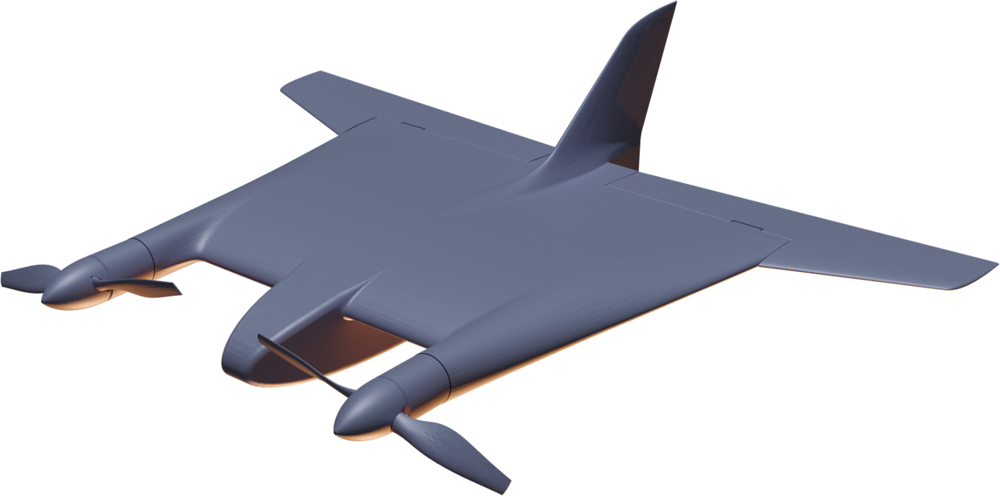

# Справка по проекту «Твин Дракен»

<section class="slide oblozhka odin">

Справка · состояние на 16.10.2026

<h1>Проект «Твин Дракен»</h1>

Перспективная аэродинамическая компоновка БПЛА самолётного типа с ЛТХ, ориентированными на задачи малой ПВО

<b>июль 2026</b>начало работ

<b>прототип</b>готов к лётным испытаниям

</section>

<section class="slide">

1 · Концепция проекта

<h2>Платформа для малой ПВО</h2>

В основе проекта лежит отработка перспективной аэродинамической компоновки БПЛА самолётного типа с ЛТХ, ориентированными на задачи малой ПВО, в том числе:

<ul class="zadachi">
<li>ведение беспилотного воздушного боя с БПЛА противника;</li>
<li>улучшение характеристик наземных средств ПВО при использовании данной платформы в качестве заведомо сложной для перехвата цели.</li>
</ul>

Основные целевые показатели
<b>Сочетание возможности полёта в большом диапазоне скоростей и высот при высокой манёвренности</b>

«Твин Дракен» · внешний облик прототипа

</section>

<section class="slide">

2 · Главное в цифрах

<h2>Расчётные характеристики: ключевые значения</h2>

Скорость, высота, манёвренность

340 <i>км/ч</i>

максимальная скорость

цель — 400 км/ч

≥ 40 <i>м/с</i>

скороподъёмность

+14 / −10 <i>G</i>

перегрузка

11 000 <i>м</i>

практический потолок

Масса, тяга, полёт

4 <i>кг</i>

максимальная взлётная масса

минимальная — 2,7 кг

1,5–2,1

тяговооружённость при нулевой поступательной скорости

до 1 <i>ч</i>

продолжительность полёта

дальность — 100 км

нет

скорости сваливания

может переходить в режим висения на винтах

</section>

<section class="slide">

2 · Расчётные характеристики БПЛА

<h2>Все значения</h2>

<table class="sravnenie odin">
<thead><tr><th class="param">Параметр</th><th class="drk">Значение</th></tr></thead>
<tbody>
<tr class="gruppa"><td colspan="2">Габариты*</td></tr>
<tr><td>Габаритные размеры</td><td class="z">650 × 740 × 220</td></tr>
<tr><td>В транспортном положении</td><td class="z">650 × 250 × 450 — при отделении элевонов 650 × 740 × 100 — в пусковом слоте при сложенном вертикальном оперении</td></tr>
<tr class="gruppa"><td colspan="2">Масса</td></tr>
<tr><td>Максимальная взлётная масса</td><td class="z">4 кг</td></tr>
<tr><td>Минимальная взлётная масса</td><td class="z">2,7 кг</td></tr>
<tr><td>Масса целевой нагрузки</td><td class="z">0,75 кг — в варианте перехватчика</td></tr>
<tr class="gruppa"><td colspan="2">Силовая установка</td></tr>
<tr><td>Силовая установка</td><td class="z">2 × 1,4 кВт</td></tr>
<tr><td>Тяговооружённость при нулевой поступательной скорости</td><td class="z">1,5–2,1 — в зависимости от массы и применяемых винтов</td></tr>
<tr class="gruppa"><td colspan="2">Скорость</td></tr>
<tr><td>Максимальная скорость</td><td class="z drk">340 км/ч цель — 400 км/ч</td></tr>
<tr><td>Экономическая скорость</td><td class="z">120 км/ч</td></tr>
<tr><td>Скорость сваливания</td><td class="z">нет — может переходить в режим висения на винтах</td></tr>
</tbody>
</table>
<table class="sravnenie odin">
<thead><tr><th class="param">Параметр</th><th class="drk">Значение</th></tr></thead>
<tbody>
<tr class="gruppa"><td colspan="2">Высота и манёвренность</td></tr>
<tr><td>Скороподъёмность</td><td class="z">не менее 40 м/с</td></tr>
<tr><td>Перегрузка</td><td class="z">+14 / −10 G</td></tr>
<tr><td>Практический потолок</td><td class="z">11 000 м</td></tr>
<tr class="gruppa"><td colspan="2">Дальность и продолжительность</td></tr>
<tr><td>Продолжительность полёта</td><td class="z">до 1 ч</td></tr>
<tr><td>Дальность полёта</td><td class="z">100 км</td></tr>
<tr class="gruppa"><td colspan="2">Взлёт и посадка</td></tr>
<tr><td>Взлёт</td><td class="z">с руки; вертикальный из слота пускового контейнера на пороховом ускорителе; катапультный</td></tr>
<tr><td>Посадка</td><td class="z">парашют или зависание над растянутой сетью с отключением двигателей</td></tr>
<tr class="gruppa"><td colspan="2">Оснащение</td></tr>
<tr><td>БРЭО</td><td>полётный контроллер, курсовая камера, видеопередатчик, модуль обработки изображения, БЧ (в случае необходимости)</td></tr>
</tbody>
</table>

* Единицы габаритов в справке не указаны.

</section>

<section class="slide">

3 · Текущее состояние проекта · 16.10.2026

<h2>Прототип готов к лётным испытаниям</h2>

<h3>Сделано</h3>

Начало работ — июль 2026 года

<ul class="shagi">
<li>Сформирован внешний облик прототипа.</li>
<li>Изготовлен и подготовлен к лётным испытаниям прототип, выполненный по обходной технологии.</li>
</ul>

Ближайшие планы

<h3>Лётные испытания прототипа</h3>

Главная цель

подтверждение жизнеспособности аэродинамической компоновки

определение путей дальнейшего развития проекта

</section>
