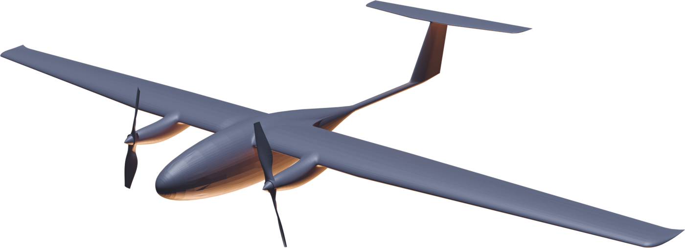

# Справка по проекту «33»

<section class="slide oblozhka odin sinii">

Справка · состояние на 16.10.2026 · варианты применения на 2027 год

<h1>Проект «33»</h1>

Высокоэффективная аэродинамическая компоновка электрического БПЛА самолётного типа — на дальность и продолжительность полёта

<b>июль 2024</b>начало работ

<b>≥ 800 км · ≥ 9 ч</b>на электрической тяге

<b>прототип</b>готов к лётным испытаниям

</section>

<section class="slide">

1 · Концепция проекта

<h2>Электрический БПЛА в нише аппаратов с ДВС</h2>

В основе проекта лежит создание высокоэффективной аэродинамической компоновки БПЛА самолётного типа с электрическим двигателем.

<ul class="zadachi">
<li>Это позволит электрическому БПЛА в значительной мере занять нишу БПЛА с ДВС при заведомо более простой и дешёвой эксплуатации.</li>
<li>Главная идея — крыло с большой корневой толщиной для относительно малых скоростей и чисел Re; внутренний объём корневой части отдан под дополнительные аккумуляторные батареи.</li>
</ul>

Основные целевые показатели
<b>Дальность и продолжительность полёта</b>

«33» · окончательный аэродинамический облик

</section>

<section class="slide">

2 · Главное в цифрах

<h2>Расчётные характеристики: ключевые значения</h2>

Дальность, продолжительность, высота

≥ 800 <i>км</i>

дальность по замкнутому маршруту

цель — 1200 км

≥ 9 <i>ч</i>

максимальная продолжительность полёта

цель — 12–14 ч

7500 <i>м</i>

практический потолок

170 <i>км/ч</i>

максимальная скорость

экономическая — 95 км/ч

Масса, нагрузка, силовая установка

24 <i>кг</i>

максимальная взлётная масса

минимальная — 10 кг

до 1,5 <i>кг</i>

масса целевой нагрузки

6 вариантов нагрузки

2 × 1,4 <i>кВт</i>

силовая установка

тяговооружённость 0,6–1,1

59 <i>км/ч</i>

скорость сваливания

без обдува крыла винтами

</section>

<section class="slide">

2 · Расчётные характеристики БПЛА

<h2>Все значения</h2>

<table class="sravnenie odin">
<thead><tr><th class="param">Параметр</th><th class="p33">Значение</th></tr></thead>
<tbody>
<tr class="gruppa"><td colspan="2">Габариты*</td></tr>
<tr><td>Габаритные размеры</td><td class="z">1600 × 3200 × 480</td></tr>
<tr><td>В транспортном положении</td><td class="z">1000 × 600 × 500</td></tr>
<tr class="gruppa"><td colspan="2">Масса</td></tr>
<tr><td>Максимальная взлётная масса</td><td class="z">24 кг</td></tr>
<tr><td>Минимальная взлётная масса</td><td class="z">10 кг</td></tr>
<tr><td>Масса целевой нагрузки</td><td class="z">до 1,5 кг</td></tr>
<tr class="gruppa"><td colspan="2">Силовая установка</td></tr>
<tr><td>Силовая установка</td><td class="z">2 × 1,4 кВт</td></tr>
<tr><td>Тяговооружённость при нулевой поступательной скорости</td><td class="z">0,6–1,1 — в зависимости от массы и применяемых винтов</td></tr>
<tr class="gruppa"><td colspan="2">Скорость</td></tr>
<tr><td>Максимальная скорость</td><td class="z">170 км/ч</td></tr>
<tr><td>Экономическая скорость</td><td class="z">95 км/ч — при максимальной взлётной массе</td></tr>
<tr><td>Скорость сваливания</td><td class="z">59 км/ч — без обдува крыла винтами</td></tr>
</tbody>
</table>
<table class="sravnenie odin">
<thead><tr><th class="param">Параметр</th><th class="p33">Значение</th></tr></thead>
<tbody>
<tr class="gruppa"><td colspan="2">Высота и прочность</td></tr>
<tr><td>Практический потолок</td><td class="z">7500 м</td></tr>
<tr><td>Расчётная перегрузка</td><td class="z">+6 / −6 G</td></tr>
<tr class="gruppa"><td colspan="2">Дальность и продолжительность</td></tr>
<tr><td>Дальность полёта</td><td class="z p33">не менее 800 км — по замкнутому маршруту цель — 1200 км</td></tr>
<tr><td>Продолжительность полёта</td><td class="z p33">не менее 9 ч — максимальная цель — 12–14 ч</td></tr>
<tr class="gruppa"><td colspan="2">Взлёт и посадка</td></tr>
<tr><td>Взлёт</td><td class="z">катапультный (с руки — при массе не более 10 кг)</td></tr>
<tr><td>Посадка</td><td class="z">парашют + баллонет в нижней части фюзеляжа</td></tr>
<tr class="gruppa"><td colspan="2">Целевая нагрузка</td></tr>
<tr><td>Варианты</td><td>камера для ортофотосъёмки, выдвижная обзорная камера, SAR (радиолокатор с синтезированной апертурой), ретранслятор радиосигнала, бортовой газоанализатор, бортовой радиометр</td></tr>
</tbody>
</table>

* Единицы габаритов в справке не указаны.

</section>

<section class="slide">

3 · Текущее состояние проекта · 16.10.2026

<h2>Прототип в окончательном облике готов к лётным испытаниям</h2>

<h3>Сделано</h3>

Начало работ — июль 2024 года

<ul class="shagi">
<li>На предварительном этапе проведены лётные испытания аналога, доказавшего жизнеспособность главной идеи проекта — использования крыла с большой корневой толщиной для относительно малых скоростей и чисел Re.</li>
<li>Отработана аэродинамическая компоновка, в частности полностью отработано крыло с переменной относительной толщиной, позволяющее использовать внутренний объём корневой части для размещения дополнительных аккумуляторных батарей.</li>
<li>Отработаны три возможные технологии изготовления крыла, различающиеся по затратам на производство.</li>
<li>Отработана силовая схема планера.</li>
<li>Выполнены работы по адаптации имеющейся в наличии целевой нагрузки (камера ZR10).</li>
<li>Подготовлен к лётным испытаниям прототип в окончательном аэродинамическом облике.</li>
</ul>

Ближайшие планы

<h3>Лётные испытания прототипа</h3>

Главная цель

подтверждение расчётных аэродинамических характеристик

</section>

<section class="slide">

4 · Тенденции в БПЛА · что важно к 2027 году

<h2>Рынок движется туда, где сильна «33»</h2>

01 · РЕГУЛИРОВАНИЕ<b>Нацпроект и стратегия беспилотной авиации до 2030 года</b>
По стратегии к 2027 году эксплуатацию БАС должны разрешить 56 регионов, к 2030-му — все 89. Целевая доля российских БАС — 70 % рынка.

→ спрос госзаказчиков на отечественные аппараты

02 · ДАЛЬНИЕ ПОЛЁТЫ<b>Полёты за пределами прямой видимости — главный сдвиг 2026 года</b>
Правила и средства предупреждения столкновений открывают дорогу дальним автоматическим маршрутам вместо коротких облётов с оператором рядом.

→ ценится дальность и автономность

03 · ПРОДОЛЖИТЕЛЬНОСТЬ<b>Электрические аппараты упираются в аккумулятор</b>
Малые электрические аппараты борются за первый час полёта; самолётные и гибридные дают 2–8 ч. Для большего идут в двигатели внутреннего сгорания и водород.

→ «33»: ≥ 9 ч (цель 12–14) на электричестве

04 · МНОГО ДАТЧИКОВ<b>Несколько задач за один вылет</b>
Обследование объекта и поиск утечек газа совмещают в одном полёте; тепловые, многоспектральные и газовые датчики становятся стандартом. Спрос на поиск утечек метана растёт.

→ 6 вариантов сменной нагрузки

05 · ГОСМОНИТОРИНГ<b>Ведомства пересаживаются с авиации на беспилотники</b>
Рослесхоз с 2026 года постепенно переходит от авиамониторинга лесов к БПЛА: дешевле и быстрее находит пожары. Самолётные аппараты — для больших площадей.

→ замена пилотируемой авиации на патрулях

06 · ОГРАНИЧЕНИЯ<b>Помехи навигации и запреты полётов</b>
Подавление спутниковой навигации и временные запреты полётов в ряде регионов стали обычной средой. Выигрывают аппараты, которые держат курс без спутников и работают в разрешённых режимах.

→ задача на доработку (слайд 9)

Источники: стратегия развития беспилотной авиации до 2030 г. (neftegaz.ru), «Профиль» — доля 70 %; обзоры отрасли 2026 (unmannedsystemstechnology.com, pgjonline.com, Sky-Futures); Рослесхоз — по сообщению ТАСС (www1.ru, 04.01.2026). Тенденция 06 — по открытым сообщениям, без отдельного источника.

</section>

<section class="slide">

5 · Варианты применения на 2027 год

<h2>Восемь направлений для «33»</h2>

1<b>Трубопроводы и линейные объекты</b>
Патруль трассы на сотни километров за вылет: утечки, несанкционированные работы в охранной зоне, размывы.

ортофотообзорная камерагазоанализаторнефтегаз

2<b>ЛЭП и энергосети</b>
Обход протяжённых линий, состояние просек, повреждения после ураганов и гололёда.

ортофотообзорная камераэлектросети

3<b>Леса и пожары</b>
Многочасовой патруль, раннее обнаружение очагов, контроль кромки, связь для наземных групп.

обзорная камераретрансляторлесхозы, МЧС

4<b>Картография и кадастр</b>
Съёмка больших площадей за один вылет: кадастр, землеустройство, учёт угодий, лесоустройство.

ортофоторегионы, агрохолдинги

5<b>Воздушный ретранслятор связи</b>
Связь в ЧС и в районах без сети: с 3000 м радиогоризонт ≈ 225 км, с 7500 м ≈ 355 км (расчёт).

ретрансляторМЧС, экспедиции

6<b>Арктика, ледовая и морская разведка</b>
Радиолокатор видит сквозь облака и в полярную ночь; взлёт с катапульты и посадка на парашюте — без аэродрома, с берега или судна.

SARобзорная камераСевморпуть, порты

7<b>Экология и радиация</b>
Выбросы промзон и полигонов, метан; радиационная обстановка у АЭС, хвостохранилищ, после аварий.

газоанализаторрадиометрприроднадзор, промышленность

8<b>Охрана границ и периметров</b>
Длительное патрулирование протяжённых рубежей и объектов днём, ночью и в непогоду.

SARобзорная камерагосзаказчики

Направления и оценки на слайдах 6–9 — аналитика к справке (ноябрь 2026), а не данные справки от 16.10.2026.

</section>

<section class="slide">

5 · Варианты применения на 2027 год · сопоставление

<h2>Что даёт «33» в каждом направлении</h2>
<table class="sravnenie primen">
<thead><tr><th class="param">Направление</th><th class="p33">Какое свойство «33» работает</th><th class="p33">Нагрузка из справки</th><th class="posl">Спрос в 2027*</th></tr></thead>
<tbody>
<tr><td>Трубопроводы, линейные объекты</td><td>≥ 800 км по замкнутому маршруту — участок до ~400 км туда и обратно за вылет</td><td>ортофото, обзорная камера, газоанализатор</td><td>высокий</td></tr>
<tr><td>ЛЭП и энергосети</td><td>дальность и экономичная скорость 95 км/ч для детальной съёмки</td><td>ортофото, обзорная камера</td><td>высокий</td></tr>
<tr><td>Леса и пожары</td><td>≥ 9 ч в воздухе — патруль на весь световой день без смены аппарата</td><td>обзорная камера, ретранслятор</td><td>высокий</td></tr>
<tr><td>Картография и кадастр</td><td>большие площади за вылет; посадка на парашют — без площадки</td><td>камера для ортофотосъёмки</td><td>средний</td></tr>
<tr><td>Ретранслятор связи</td><td>потолок 7500 м и часы барражирования над районом</td><td>ретранслятор радиосигнала</td><td>высокий</td></tr>
<tr><td>Арктика, ледовая разведка</td><td>старт без аэродрома, дальность; нужна работа на холоде</td><td>SAR, обзорная камера</td><td>средний</td></tr>
<tr><td>Экология и радиация</td><td>дешёвый в эксплуатации электрический аппарат для регулярных облётов</td><td>газоанализатор, радиометр</td><td>средний</td></tr>
<tr><td>Охрана границ и периметров</td><td>продолжительность и всепогодный радиолокатор</td><td>SAR, обзорная камера</td><td>высокий</td></tr>
</tbody>
</table>

* Оценка по тенденциям со слайда 6, не данные справки. Участок трассы и время патруля — пересчёт характеристик из справки.

</section>

<section class="slide">

6 · Что усилит «33» к 2027 году

<h2>Доработки и риски</h2>

<h3>Что стоит добавить</h3>
<ul class="spisok">
<li><b>Навигация без спутников</b> — по камере и инерциальным датчикам, чтобы держать маршрут при помехах.</li>
<li><b>Тепловизор в обзорной камере</b> — для пожаров, ЛЭП и ночной охраны.</li>
<li><b>Обработка снимков на борту</b> — аппарат сам отмечает утечку, очаг, нарушение; по каналу идёт только находка.</li>
<li><b>Дальняя связь</b> — защищённый канал, работа через ретранслятор или спутник для полётов за пределами видимости.</li>
<li><b>Подогрев батарей</b> — для Арктики и зимних полётов.</li>
<li><b>Экспериментальные правовые режимы и сертификация</b> — без них нет регулярных коммерческих полётов.</li>
</ul>

<h3>Риски</h3>
<ul class="spisok">
<li><b>Характеристики пока расчётные.</b> Подтвердить их — главная цель ближайших испытаний.</li>
<li><b>Запреты полётов</b> в ряде регионов сужают рынок до разрешённых зон и госзаказчиков.</li>
<li><b>Нагрузка до 1,5 кг.</b> Для радиолокатора, скорее всего, на пределе — проверить по массе выбранной модели.</li>
<li><b>Холод сокращает дальность</b> на аккумуляторах — для северных задач нужен отдельный расчёт.</li>
<li><b>Конкуренция</b> с аппаратами на ДВС и гибридами; козырь «33» — простота и дешевизна эксплуатации.</li>
</ul>

</section>
