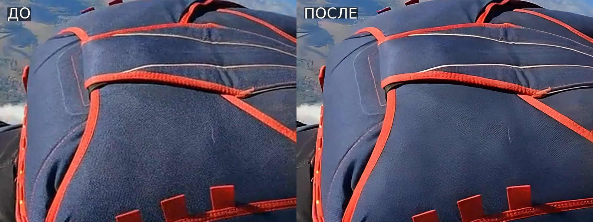

# Улучшение видео на своём компьютере

Как убрать пикселизацию и следы сжатия и поднять чёткость видео нейросетью
на домашнем компьютере с видеокартой. Обработка на сервере не подходит:
видеокарты там нет, и минута видео обрабатывается около 9 часов. С видеокартой
та же работа занимает минуты.

## 1. Проверьте видеокарту

Откройте **Диспетчер задач** (Ctrl + Shift + Esc) → вкладка
**Производительность** → пункт **Графический процессор**. Там написано
название видеокарты.

| Видеокарта | Подходит ли |
|---|---|
| NVIDIA GeForce GTX 1060 и новее, RTX любая | Да |
| AMD Radeon RX 500 и новее | Да |
| Intel UHD, Iris Xe, Arc | Работает, но в несколько раз медленнее |
| Видеокарты нет | Не подходит: нужна аренда видеокарты |

Кроме того, нужна Windows 10 или 11, 64-разрядная.

## 2. Обновите драйвер видеокарты

Скачайте свежий драйвер с сайта производителя:

- NVIDIA — nvidia.com/drivers;
- AMD — amd.com/support;
- Intel — intel.com, раздел «Драйверы и ПО».

Если драйвер старый, программа может не увидеть видеокарту и начнёт считать
на процессоре, то есть очень медленно.

## 3. Video2X — бесплатно

### Установка

1. Откройте страницу **github.com/k4yt3x/video2x/releases**.
2. В самой верхней версии раскройте список **Assets** и скачайте установщик
   для Windows. В его названии есть слова `windows` и `installer`, а оканчивается
   оно на `.exe`.
3. Запустите установщик. Если Windows предупредит о неизвестном издателе,
   нажмите «Подробнее» → «Выполнить в любом случае».

### Обработка

Названия пунктов в окне программы могут немного отличаться от версии к версии,
смысл такой:

| Настройка | Что выбрать | Зачем |
|---|---|---|
| **Add** / Добавить | ваше видео | — |
| **Processor** | `Real-ESRGAN` | Нейросеть для восстановления детализации |
| **Model** | `realesr-general-x4v3` | Обучена на сжатых записях с телефона и камеры. Модели с `anime` в названии — только для мультфильмов |
| **Scale** | `2x` | Обычно этого достаточно. `4x` работает дольше и сильнее дорисовывает |
| **Device** / GPU | ваша видеокарта | Если выбран процессор, обработка будет идти в десятки раз дольше |
| **Encoder** | H.264 или H.265 | H.265 даёт файл меньше, но не всякий телефон его откроет |
| **CRF** / качество | около 18 | Меньше число — выше качество и больше файл |

Нажмите **Start**. Внизу окна видны ход обработки и оставшееся время.

### Сначала короткий отрывок

Вырежьте из видео 10–20 секунд, на которых пикселизация видна сильнее всего,
и обработайте сначала их. По этому отрывку станет ясно, устраивает ли качество
и сколько займёт всё видео: время на отрывок умножается на длину ролика.

### Если результат не устраивает

- **Лица и предметы стали «пластиковыми»**: поставьте Processor `Real-CUGAN`
  и сравните.
- **Квадраты сжатия остались**: попробуйте `4x`, а потом уменьшите результат
  до нужного размера в любом видеоредакторе.
- **Программа пишет об ошибке Vulkan или не видит видеокарту**: обновите
  драйвер (шаг 2) и перезагрузите компьютер.

## 4. Topaz Video AI — платно, но лучше по качеству

Если Video2X не справился с пикселизацией, попробуйте Topaz Video AI.

1. Скачайте программу на **topazlabs.com** (раздел Video AI). Есть пробный
   период: результат в нём с водяным знаком, но качество оценить можно.
2. Перетащите видео в окно программы.
3. Справа выберите модель:

| Модель | Для чего |
|---|---|
| **Proteus** | Обычная съёмка. Ползунками регулируются резкость, снятие следов сжатия и шума |
| **Iris** | Лица и сильно сжатое видео низкого качества |
| **Nyx** | Сильный шум (съёмка в темноте) |

4. Нажмите **Preview**: на кадре появится сравнение «до» и «после».
   Подберите модель и ползунки на самом проблемном месте ролика.
5. Нажмите **Export**.

Полная лицензия стоит около 300 $ в год. Видеокарта для неё нужна так же,
как для Video2X.

## Чего ждать от результата

Нейросеть хорошо убирает квадраты сжатия, шум и мыло. Но если картинка
разбита на крупные пиксели, настоящих деталей в ней уже нет, и сеть
дорисует их сама. Лица и мелкие надписи могут получиться не такими, как
в жизни. Чем лучше исходник, тем точнее результат: если есть оригинал
с камеры или телефона, берите его, а не копию из мессенджера.

Если что-то не заработает, пришлите снимок экрана с ошибкой.
